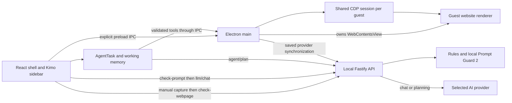

# Orbit Browser Architecture

This document describes the current working-tree implementation of the project **Prompt Injection Defense in an AI-Native Browser**, reviewed on **30 September 2026**. The desktop product is named **Orbit**, its frontend package is `orbit-browser`, and its assistant is **Kimo**. Older package, storage, and window names still contain PromptGuard or Prompt Defense. Its React interface provides browser tabs, a manual webpage scan, AI chat, provider settings, and autonomous Agent Mode. A local Node.js/Fastify service performs prompt-injection classification and connects to a user-selected AI provider.

Descriptions below distinguish executable behavior from retained helpers and proposed protections. In particular, the project implements manual webpage detection and a direct-chat-prompt gate; it currently does **not** automatically classify the page state, tool observations, or user goal supplied to Agent Mode. A project objective of protecting autonomous browsing must not be presented as an already-enforced end-to-end property.

## Chapter 1 — System Boundaries

Orbit runs three application-controlled parts, with external websites executing in separate Chromium guest renderers:

| Part | Implementation | Main responsibility |
| --- | --- | --- |
| Electron main process | frontend/electron/main.ts | Owns the application window, guest tabs, IPC handlers, CDP sessions, file picker, provider settings, and packaged backend lifecycle. |
| React renderer | frontend/src/App.tsx (welcome screen), frontend/src/components/BrowserShell.tsx (the browser itself, loaded as its own chunk) and frontend/src/components/ | Renders the browser controls, scan reports, chat, provider settings, and Agent Mode; keeps tab and UI state. |
| Local backend | backend-node/src/server.ts and backend-node/src/app.ts | Serves the /api/v1 HTTP API on 127.0.0.1:8000 by default; classifies text, builds agent plans, and calls AI providers. |

The renderer calls Electron main through the API exposed by frontend/electron/preload.ts. The renderer and Electron main also call the local backend over HTTP. Browsed websites live in separate, main-owned WebContentsView instances; their page objects are not part of the React DOM.

The principal flows cross those boundaries as follows:

| Flow | Path through the implementation |
| --- | --- |
| Manual page scan | Toolbar in React → BrowserWebView handle → preload scanWebview → Electron CdpInspectionService → backend /security/check-webpage → webpage analysis drawer. |
| Chat | AI sidebar → backend /security/check-prompt → backend /llm/chat → active provider gateway → chat message in the sidebar. |
| Agent action | AgentTask in React → backend /agent/plan → frontend tool/approval handling → preload runtimeInvoke → Electron BrowserRuntime → guest tab through CDP. |

The local classifier and the selected generative model have different roles. Prompt Guard 2 detects injection; the selected provider answers chat questions and plans agent actions. Calling the planner does not invoke the classifier.

## Chapter 2 — Repository and Entry Points

| Path | Implemented role |
| --- | --- |
| frontend/electron/main.ts | Electron startup, guest-tab lifecycle, IPC, shared CDP sessions, provider synchronization. |
| frontend/electron/preload.ts | Exposes window.electronAPI to the renderer. |
| frontend/electron/browserRuntime/ | Typed runtime contract, CDP session registry, semantic state builder, element resolver, input dispatch, waits, verification, advanced guest-page tools, and visual overlay. |
| frontend/electron/cdpInspectionService.ts | Captures page content channels for the manual scanner and the runtime's security-snapshot command. |
| frontend/src/App.tsx | Welcome screen; loads and mounts the browser shell when the user starts. |
| frontend/src/components/BrowserShell.tsx | Browser shell, tabs, navigation, bookmarks, assistant state, and manual scan orchestration. The assistant, provider settings modal, and report drawers are separate chunks, mounted on first use (see frontend/src/utils/deferredComponent.ts). |
| frontend/src/components/ | Browser UI, AI sidebar, scan results, agent controls, and provider settings. |
| frontend/src/services/ | HTTP clients, page-content adapter, agent loop, tool mapping, approval policy, task working memory, temporary session memory, and retained browser-memory/recovery helpers. |
| frontend/src/utils/ | Deferred component loading, model-capability heuristics, and browser-side DOCX extraction. |
| backend-node/src/app.ts | Builds Fastify, configures CORS and errors, waits for classifier initialization, and registers routes. |
| backend-node/src/routes/ | Health, security, chat, agent planning, and provider endpoints. |
| backend-node/src/services/ | Text preparation, detectors, explanations, planner, tool validation, provider manager, and gateways. |
| backend-node/src/dl/ | Local Prompt Guard 2 loading and ONNX inference. |
| backend-node/dl_models/prompt_injection_model/ | Model configuration, tokenizer, provenance in SOURCE.md, and locally provisioned onnx/model.onnx weights. Weights are Git-ignored. |
| frontend/scripts/ | Development launcher, production backend staging, and standalone regression checks. |
| backend-node/test/ and frontend/e2e/ | Backend Vitest and desktop Playwright tests. |

The active backend is TypeScript/Fastify. The frontend is TypeScript/React/Electron. The current frontend scripts build and start backend-node; no Python service is part of this runtime.

## Chapter 3 — Application Startup and Process Communication

In development, frontend's npm run dev invokes scripts/run-dev.mjs, which starts the dev:processes script. That script builds and starts the backend, starts Vite on localhost:5173, watches Electron TypeScript, waits for Vite and the backend health endpoint, and launches Electron. With PROMPT_DEFENSE_DEV=true, Electron does not spawn a second backend.

In packaged or end-to-end runs, frontend/electron/backendProcess.ts starts the compiled backend with Electron's executable in Node mode (`ELECTRON_RUN_AS_NODE=1`), sets `APP_ENV=production` and `PORT=8000`, polls /api/v1/health for up to 15 seconds, and stops the child process when the app quits. Electron starts this work concurrently with window creation: the welcome screen does not wait for backend readiness. After the startup promise resolves, main attempts provider synchronization. Backend startup is best effort; health timeout or child failure is logged and does not prevent the window from opening. There is no automatic backend restart supervisor.

backend-node/src/server.ts binds Fastify to 127.0.0.1. The three frontend HTTP clients, provider synchronization, and health polling target 127.0.0.1:8000/api/v1, so changing `PORT` or `API_V1_PREFIX` alone does not update their targets. `env.ts` loads dotenv from the process working directory; model paths are also resolved relative to that directory. The child spawn currently does not set an explicit working directory or model path.

The preload bridge exposes tab creation/navigation/history/reload/stop, tab information, events and bounds, popup lifecycle events, manual page capture, typed browser-runtime invocation, and provider-setting operations. It exposes neither a generic IPC invocation function nor an app-version operation. Electron main checks that browser-tab, manual-scan, and runtime requests come from the app window. The runtime also requires a registered target before it can act on a tab. Provider IPC handlers currently do not perform the same sender check.

## Chapter 4 — Browser Shell and Tabs

BrowserShell.tsx owns the visible tab list, selected tab, address bar state, bookmarks, scan state, assistant state, and active runtime target ID. BrowserWebView.tsx normally creates a guest tab through browser:create-tab when mounted and closes it when unmounted. For a site-created popup, it instead adopts the existing webContents ID supplied by main. The component keeps that ID as its handle; Electron main keeps the matching WebContentsView.

The browser toolbar offers address/search submission, back, forward, reload/stop, bookmark toggling, manual Scan, and the AI sidebar. The shell also provides new and close tab behavior and persists bookmarks and assistant width in renderer localStorage. The new-tab/home screen is rendered by React. Outside Electron, BrowserWebView renders an iframe preview; the main-process browser runtime is available only in Electron.

Main sends loading, navigation, title, favicon, and load-failure events back to the renderer. BrowserWebView reports its React container bounds to main so the native guest view can be placed over that area. It gives the view zero bounds when its tab is inactive, the home screen or an error is shown, or a drawer/modal or resize interaction must cover it.

BrowserToolbar and BrowserWebView implement the main browser surface. AiAssistantSidebar hosts Chat and AgentModePanel. WebpageAnalysisDetailsPanel and PromptAnalysisDetailsPanel display separate detector results; ProviderSettingsModal manages AI connections. These components receive state and callbacks from the shell rather than owning guest webContents directly.

### Popup authentication, downloads, and browser lifetime

Guest `window.open` and target-blank requests are routed into the main tab strip by `setWindowOpenHandler().createWindow`. Main adopts Electron-supplied `options.webContents` when present and returns that exact object, retaining opener relationships and avoiding `Invalid webContents`. The popup uses the opener's Electron session, isolated context, sandbox, and disabled Node integration. If Electron supplies no child contents, main loads the requested URL with available referrer and POST body. Popup creation/closure events synchronize the tab strip with the guest lifecycle.

Normal tabs use the default Electron session; popups explicitly share their opener's session. Chromium owns cookies and authentication state. This is separate from agent session memory. The implementation is intended to preserve sign-in across tab navigation and refresh; the local popup/cookie regression test does not establish compatibility with every live OAuth provider.

`webviewContextMenu.ts` provides native navigation, save, inspection, and DevTools actions. Downloads on `session.defaultSession` invoke an Electron save-location dialog; cancellation cancels the download. There is no planner download tool or agent-facing filesystem verification of the saved file. Tabs themselves are held in renderer/main memory, without implemented restoration of the previous tab list after restart.

## Chapter 5 — CDP Capture and Browser Actions

Each guest webContents has one CdpSession in CdpSessionRegistry. The manual content inspector and the agent BrowserRuntime share that attachment because Electron permits one debugger attachment per webContents. The session enables requested CDP domains, fans out protocol events, and attempts to reattach after a detach.

CdpInspectionService captures the main frame and available child frames with an isolated-world collector. It reads visible text, hidden text, comments, metadata, form values, accessibility text, open shadow-root text, inline scripts/styles, generated CSS text, external script/stylesheet URLs, and observed source-map references. It also reads a DOM snapshot. It does not fetch external script bodies, external stylesheet bodies, or source-map files. Main-frame channels come from the main frame; child-frame visible/hidden/shadow text is combined into iframe_content rather than merging all child-frame channels. Closed shadow roots and unavailable frames can be omitted.

Capture is bounded: the frame collector normally caps each channel at 30,000 characters, aggregate clipping at 60,000 characters, and source-map references at 100 entries with 2,000 characters per entry. These bounds and best-effort collection mean a clean result describes the captured subset, not every byte of the website. Source-map observations are held per attached guest session; capture does not explicitly reset them on each navigation.

The agent BrowserRuntime accepts commands through the runtime contract in frontend/electron/browserRuntime/runtimeContract.ts, mirrored in frontend/src/types/browserRuntimeTypes.ts. Its page-state builder turns accessibility-tree data into a capped PageStateSnapshot containing named controls, element IDs, values and control states, nearby text/container context, focus, dialogs, validation errors, selection, URL, title, capture time, and a truncation flag. It caps interactive elements at 500, dialogs at 25, and validation issues at 50; the backend planner renders at most 450 elements. Element handles stay inside main and are refreshed on state extraction or invalidated by runtime navigation. They are not durable identifiers across planning rounds.

Runtime commands include target description, navigation, click, fill, type, key press, scroll, upload, navigation/DOM waits, screenshot, semantic state extraction, a security snapshot, visual overlay, JavaScript evaluation, selector bounds, direct mouse events, drag, and virtual-table extraction. The runtime resolves controls to CDP nodes/coordinates, dispatches input through CDP, settles the page, and returns action verification where applicable. These are Chromium CDP input events rather than operating-system input automation. The planner registry accepts absolute HTTP(S) navigation URLs; the lower-level runtime additionally accepts the `about:` scheme. These checks do not inspect all subsequent redirects or link destinations.

`advancedBrowser.ts` evaluates planner-supplied JavaScript in the registered guest page with a default 5-second evaluation timeout, a maximum 15-second timeout, and JSON output capped at 100,000 characters. Selector bounds support open-shadow-root selectors using `>>>`. Mouse coordinates are guest-viewport CSS coordinates and are validated against the viewport. Drag interpolates a left-button gesture and releases the button in a finally block. Virtual-table extraction reads recycled rows afresh, deduplicates stable IDs, checks contiguous row indices, and returns row evidence, missing indices, a completeness flag, and TSV. It defaults to 20 rows and limits requests to 100 rows, 20 columns, 100 wheel events, and a 25-second collection deadline. These observations enter working memory and trigger replanning before dependent actions.

Upload asks the user to choose files in an Electron dialog; the planner supplies an element ID rather than local paths. Main applies selected paths with `DOM.setFileInputFiles`. The planner is not given those paths by this operation. The runtime does not expose a terminal, arbitrary filesystem access, or a dedicated email integration.

Verification compares pre/post URL, accessibility structure, scroll position, field value, checked state, and expanded state as appropriate. DOM settling polls the accessibility tree at 150 ms intervals until two successive stable comparisons; post-action settling also attempts a short network-quiet wait. This is a readiness/observed-change mechanism, not proof of business-task completion or injection safety. Screenshots and security capture are available runtime commands but are not registered planner tools.

## Chapter 6 — Backend API

backend-node/src/app.ts registers these route groups under the configured prefix, /api/v1 by default:

| Method and path | Current behavior |
| --- | --- |
| GET /health | Reports health, backend/runtime versions, model load status, classifier mode, and model precision. |
| POST /security/check-prompt | Classifies a nonempty direct prompt and returns a detailed decision. |
| POST /security/check-webpage | Classifies nonempty captured webpage channels separately and returns a detailed decision. |
| GET /security/events | Returns recent security-analysis events from an in-memory store. |
| POST /llm/chat | Rechecks the supplied prompt, then sends approved chat data to the active provider or returns the no-provider response. |
| POST /agent/plan | Uses the active provider to produce and validate an action queue for the given goal, working memory, and page state. |
| GET /agent/tools | Lists the planner's registered tools and parameter metadata. |
| GET /providers/presets | Returns provider presets. |
| POST /providers/models and POST /providers/test | Fetches models or tests candidate provider credentials. |
| GET, POST, DELETE /providers/active | Reads, sets, or clears the provider active in backend memory. |
| POST /providers/configured | Loads configured providers into backend memory for fallback operations. |

Fastify uses TypeBox request/response schemas on the principal security, chat, agent, and provider routes, with a 50 MiB request-body limit. app.ts waits for local classifier loading to finish, successfully or in fallback mode, before registering routes. Request validation failures use status 422 and a `{detail}` body; empty prompts/goals or scans without classified content use 400, unknown routes use 404, and unhandled server failures use an Internal Server Error detail. Agent provider failures use 502. No crawler, `/agent/security/check-page`, agent-security-events, or audio-transcription route is registered.

## Chapter 7 — Prompt-Injection Detection

The manual security routes use analyzeText in backend-node/src/routes/security.routes.ts. It preprocesses input, splits each source into overlapping chunks, calls promptClassifier.classifyMany once for the batch, and aggregates the result. Defaults are 800 characters per chunk with 100 characters of overlap. A single malicious chunk makes the overall decision disallowed. Direct prompts are chunked after preprocessing; webpage channels are chunked from their original channel text to retain source evidence. Preprocessing strips HTML where applicable, lowercases, and normalizes whitespace. Its token_count is a whitespace-word count, not the transformer tokenizer count; Unicode NFKC normalization is not implemented.

promptClassifier runs the rule detector and, when loaded, the local Prompt Guard 2 classifier. A chunk is malicious when either detector matches. The rule detector reports matched categories and phrases; the model supplies a MALICIOUS score. Results carry detector source, confidence, matched patterns, and per-chunk explanations for the UI. The response also contains preprocessing and chunking metadata, feature evidence, a final rationale, classifier mode, and model precision.

The five rule categories in backend-node/src/core/securityConstants.ts are override_instructions, jailbreak_attempt, hidden_instruction, system_prompt_reveal, and data_exfiltration. RuleBasedDetectorService uses whole-word matching at alphanumeric term boundaries. Common short or ambiguous terms, including dan, jailbreak, and upload to, require nearby instruction-like wording before they count; the proximity window is 160 characters.

The ONNX model loader reads local fp32 Llama Prompt Guard 2 22M artifacts from MODEL_DIR through @huggingface/transformers and onnxruntime-node. Repository model configuration identifies a DeBERTa-v3-xsmall backbone and BENIGN/MALICIOUS labels; SOURCE.md documents provenance. The model pipeline is cached once per backend process and remote model loading is disabled. If it cannot load, the service reports rule_based_fallback and continues with rules. If an already-loaded model throws during inference, the classifier marks the affected batch malicious and records an error instead of treating it as clean.

The model has a 512-token context window. Inputs exceeding it are split into overlapping subchunks, starting at 400 characters and shrinking as needed to a minimum of 100, before batched inference. The maximum MALICIOUS score over a chunk's subchunks becomes its model score. Forward passes use up to eight sequences and a 15-second timeout per batch. The tokenizer also has its maximum length pinned to 512. These protections reduce silent truncation within classifier inputs; they cannot recover content omitted or clipped during capture.

DL_MALICIOUS_THRESHOLD (default 0.5) determines when the model flags a chunk. Risk labels are separate: confidence at least 0.85 is high, at least CLASSIFIER_THRESHOLD (default 0.7) is medium, otherwise low. CLASSIFIER_THRESHOLD is not the model's allow/block threshold. The reported confidence includes rule heuristics and fixed benign-response values; it is not a measured accuracy metric. The security endpoints store verdict summaries in securityEventStore, limited to the 50 latest events and returned newest first. The /llm/chat final check calls the classifier directly and does not create an analyzeText event.

## Chapter 8 — Manual Webpage Scan and Report

The toolbar Scan action is implemented in BrowserShell.tsx. It asks the active BrowserWebView handle to capture its guest page through security:scan-webview, sends the captured object to POST /security/check-webpage, and opens the webpage analysis drawer. Prompt analysis and webpage analysis have separate renderer state so their results are not mixed.

The backend classifies **13 channels**, comprising 11 core channels and two extended reference channels. It preserves the channel name on each chunk so the report can identify where a finding came from.

| Channel | Captured material |
| --- | --- |
| visible_text | Main-frame body innerText. |
| hidden_text | Text from elements hidden by selected attributes or computed styles. |
| html_comments | DOM comment contents. |
| meta_tags | Meta content attribute values. |
| input_values | Input, textarea, select, and option values/text. |
| aria_text | Accessibility-related attributes and an accessibility-tree text dump. |
| iframe_content | Available child-frame visible, hidden, and open-shadow-root text. |
| shadow_dom_content | Text in accessible open shadow roots. |
| inline_javascript | Inline script text. |
| css_content | Inline style text and external stylesheet URLs. |
| css_generated_content | Computed before/after pseudo-element content. |
| external_javascript | External script URLs, not fetched script bodies. |
| source_maps | Observed script-URL → source-map-URL references, not source-map bodies. |

page_title and url accompany capture but are not classified channels. Captured dom_snapshot_content is deliberately excluded. Redirects, third-party resources, suspicious domains, frame-navigation logs, runtime-script activity, and loaded-resource logs are not current scan channels, even where older documents describe a 22-channel scanner.

The manual scan produces a report for the user. It does not automatically stop ordinary browser navigation or automatically scan every page load. Capture and classification happen when the user invokes Scan.

## Chapter 9 — AI Chat

AiAssistantSidebar.tsx provides chat sessions and Agent Mode in the same sidebar. Chat sessions, including message-associated attachment data, are stored in renderer localStorage on a best-effort basis. A user can optionally attach the active page; the sidebar then captures the page and passes its visible_text, title, and URL as chat context. LlmProviderManager includes at most 25,000 characters of page context and the last 20 history messages.

On chat submission, the sidebar calls POST /security/check-prompt for the user's typed prompt. It calls POST /llm/chat only if that response allows the prompt. /llm/chat classifies the prompt again and rejects a malicious result with HTTP 403 before forwarding. llmProviderManager builds a provider message from its system instruction, recent history, optional page context, attachments, and the user request. With no active provider, chat returns an explicit no-provider response; Agent Mode planning instead returns unavailable.

The current checks cover the prompt field. The attached page text, prior history, and file attachments are not individually passed through the webpage or prompt scanner on this chat path. The final /llm/chat check also classifies only the prompt field. A manual Scan result does not become an automatic chat authorization gate.

### Attachments and model selection

PromptInputBox stages images, PDF, DOCX, and text files. Text and DOCX content can be extracted in the renderer; backend documentTextExtractor also implements basic DOCX ZIP/XML and PDF text-stream extraction, with UTF-8 fallback. This is best-effort parsing rather than a complete document/OCR engine. Non-image attachment text is added to the user message with a 50,000-character cap per file; provider gateways encode image attachments in their respective formats. This does not establish universal native PDF, audio, or video support.

`modelCapabilities.ts` uses provider/model-name heuristics to enable attachments and show compatibility errors, not live capability discovery. PromptModelPicker switches the active provider/model used by chat and planning. Gateway model-list requests generally use 15-second timeouts and completions 40-second timeouts. Provider chat errors are returned as explanatory chat content; planning errors become an HTTP failure for the agent to handle.

## Chapter 10 — Autonomous Agent Mode

AgentModePanel starts AgentTask in frontend/src/services/agentRuntimeCore.ts for the active guest target. On each planning round, AgentTask extracts a semantic page state, updates working memory, and calls POST /agent/plan. The backend planner builds a request for the active AI provider, parses the response, validates tool names and arguments against agentToolRegistry, and returns an action queue with confidence and approval metadata. An unconfigured provider yields HTTP 503; invalid plans yield HTTP 422.

The registered planner catalogue contains **16 tools**:

| Planner tools | Executor and purpose |
| --- | --- |
| click, fill, type, press_key, navigate, scroll, upload, wait | Frontend mapping to main-process browser actions; wait maps to DOM stability. |
| evaluate, element_bounds, dispatch_mouse_event, drag, extract_virtual_table | Advanced guest-page observation/action commands in advancedBrowser.ts. |
| open_tab | Agent loop calls the shell to create/select a tab and switches its target ID. |
| extract | Agent loop records a planner-supplied finding; it is not a separate automatic DOM scrape. |
| finish | Agent loop records a terminal result and ends execution. |

Backend validation accepts one to four actions per plan, rejects unknown tools/arguments, enforces argument types and current element IDs, and checks queue coherence. Upload must be alone; nothing follows finish or an advanced observation tool; element-dependent actions and press_key cannot follow navigate. The planner instructions also require replanning after navigate/open_tab. The frontend ends a queue when it changes targets, navigates, receives an advanced observation, encounters a failure, or refuses an action. Instructions in the prompt are broader than some validator checks and must not be treated as mechanically enforced invariants.

Executed and recorded loop actions count toward the default **150-step** limit, including finish and loop-handled actions. Pre-execution refusals do not all advance that counter, so separate streak limits prevent endless retries. Planner requests have a 45-second frontend timeout; up to 12 consecutive recoverable planning failures are retried with backoff from 500 ms to a maximum of 4 seconds. An unconfigured provider stops the task immediately. Six consecutive guard refusals stop the task. Stagnation detection refuses three matching action/page signatures in a nine-action window, or four matching semantic intents in a ten-action window. Routine observation/scroll tools are exempt from those windows. These are bounded execution safeguards, not an injection classifier.

### Approval behavior and operational limits

The frontend approval policy pauses for upload and for click/key actions whose accessible labels match financial, destructive, or submit-like patterns. Recognized cookie-consent dismissals are exempted. File upload has an additional main-process file picker. A declined approval ends the task. These label heuristics do not determine the effect of arbitrary JavaScript, coordinates, drag, or every keyboard submission, and are not a general consequence-aware authorization layer.

The backend returns needs_user_confirmation when confidence is below AGENT_MIN_CONFIDENCE (0.6). However, all currently registered **non-upload tools have a frontend confidence threshold of zero**, including click, navigate, finish, evaluate, and drag. Consequently that backend flag alone does not pause those tools. Upload requires approval regardless of confidence; an unknown frontend tool would use the fallback threshold of 0.6. Historical 0.70 click, 0.65 navigate, and 0.75 finish thresholds are not the current configuration.

AgentTask checks existing blocked-origin memory only for planned navigate/open_tab URLs. It does not automatically block the initial page, page-triggered popups, link navigation, or redirects based on this memory. The current loop does not automatically create new blocked-origin records from a scan.

### Working memory, session continuity, and retained helpers

The backend planner is stateless between requests. Continuity comes from the renderer's AgentWorkingMemory snapshot, supplied on every planning round:

| Layer | Current contents and bounds | Lifetime/use |
| --- | --- | --- |
| Recent action/failure log | Up to 40 completed steps and 20 failures, plus retry count, page URL, invalid element IDs, and a brief previous thought. The planner renders the last 20 steps and six failures. | One AgentTask, in renderer memory. |
| Progress and milestones | Up to 15 checklist items and 40 milestones; the first five milestones and newest entries are retained at the cap. The planner renders the last 30 milestones. | One task, with more durable progress than the rolling step log. |
| Entered-content ledger | Up to 30 entries, with full text retained locally for similarity checks and previews/status in the transmitted snapshot; the planner renders the last 12 entries. | One task; detects duplicate append-style type actions. |
| Findings/observations | Up to 100 findings, including planner notes and serialized advanced-tool observations, labeled as untrusted data in the planner prompt. | One task; can contain website-derived data. |
| AgentSessionMemory | Last five terminated-task summaries, each with goal, status, outcome, final URL, and up to 12 milestones. Goal/outcome are capped at 400 characters. The planner renders only the last three tasks. | Current renderer lifetime; supports follow-up references across tasks. |
| AgentBrowserMemory helper | localStorage schema for up to 50 origins and 30 successful interaction patterns per origin, plus blocked flags. | Persistent helper; the active loop currently reads blocked flags only. |

Session memory is a structured summary, not a full execution transcript or permanent memory. It disappears when the app closes **or the app renderer reloads**. Starting a new agent task remounts the panel but does not explicitly clear the module's session-memory singleton. Follow-up goals receive previous summaries as context; repeated goals are instructed to run anew. Normal completed, failed, cancelled, and declined exits pass through finalResult and record a summary; an unexpected exception caught only by the UI can bypass that recording.

The entered-content guard compares normalized text and word overlap for type actions of at least 40 characters; cross-document comparisons require at least 200 characters on each side. Fill replaces a field and is not refused by this duplicate guard. Failed ledger entries are excluded. If typing succeeds at the CDP level but a canvas editor hides its contents from accessibility verification, the loop records it as **unverifiable**, treats it as delivered, and prevents retyping. This avoids duplicate documents, but is not proof that the requested text was saved correctly.

AgentBrowserMemory exposes recordVisit, recordSuccess, markBlocked, and hintsFor, but the active loop does not call them to learn or feed hints to the planner. AgentRecoveryEngine is retained and exercised by a standalone validation script but is not imported by AgentTask; live recovery consists of loop guards, failure memory, and replanning. Neither helper should be described as a fully integrated learning/recovery subsystem.

### Planner instructions and user-visible execution

The planner interprets the original goal language, including Roman Urdu, in the same model request; there is no separate translation round trip. Its system prompt labels page state and observations as untrusted, tells the model to ignore embedded instructions, preserve the user goal, and verify requested outcomes. This is a prompt-based defense rather than automatic classifier enforcement.

AgentModePanel displays the goal, action timeline, public planning/activity summaries, approval requests, stop control, and a result that can expand into a modal. AgentResultMessage renders structured output and Markdown. The panel remains mounted when the user switches to Chat, preserving a running task; starting a new agent task remounts it and aborts the previous task. Cancellation is observed between actions and in planner fetches; an already-dispatched CDP operation need not stop immediately. A running task keeps its own target ID; changing the visible browser tab does not automatically retarget it. The loop retargets through its open_tab operation.

Agent Mode does not scan pages or its goal. The agent security pipeline, circuit breaker, threat-details modal, and backend agent security service/event store were removed, and /agent/plan does not classify the page state or goal it receives. Page state and observations reach the provider without that gate. Remaining defenses are planner instructions, tool/runtime validation, approval heuristics, bounded loop guards, and checks of existing blocked-origin flags. The Browser Runtime still has a security-snapshot command, but nothing in the agent loop calls it or classifies its output. The manual Scan action is the only current prompt-injection classification of captured webpage channels.

## Chapter 11 — AI Providers and Stored Data

The provider settings UI uses frontend/src/services/providerApiClient.ts and the preload provider APIs. In Electron, frontend/electron/providerSecureStore.ts saves provider configurations to provider_settings.json under the app's prompt-defense-browser data directory. It returns masked keys to the UI, keeps the active provider/model selection, and syncs decrypted configurations to the backend. The backend LlmProviderManager holds its active gateway and configured providers in process memory; Electron syncs the saved selection after startup and on relevant setting changes.

Provider gateway implementations cover OpenAI-compatible endpoints, Anthropic, and Gemini. The backend factory contains 12 presets: OpenCode Zen, Google Gemini, Anthropic, OpenAI, NVIDIA NIM, AgentRouter, Cloudflare Workers AI, OpenRouter, TokenRouter, NaraRouter, OpenAdapter, and Custom Provider. These are configuration presets, not a guarantee of current external service availability or model capability. The backend exposes candidate model fetching and connection tests. Chat and planning use the active gateway, including OpenRouter auto-model selection when configured without a selected model. No provider is seeded from backend environment credentials, and the backend does not persist settings to its own file.

ProviderSecureStore uses Electron safeStorage encryption when available. When it is unavailable or encryption fails, it stores the key with a b64: Base64 prefix, which is encoding rather than encryption. Candidate keys also pass through renderer memory and the local HTTP API for model listing/testing before secure storage. The non-Electron providerApiClient fallback stores provider metadata in localStorage after deleting api_key from the saved object; credentials used to activate a provider remain in backend process memory and are not restored from that metadata after restart. This fallback is not an equivalent credential vault.

Renderer localStorage also holds bookmarks, assistant width, chat sessions, and origin-based agent browser memory. Security events and the backend's provider state are in memory and do not survive a backend restart on their own.

| Data | Storage owner/location | Persistence |
| --- | --- | --- |
| Website cookies/authentication | Chromium default/opener Electron session under app userData. | Managed by Chromium and cookie lifetime. |
| Bookmarks and sidebar width | Renderer localStorage. | Survives renderer/app restart when storage remains available. |
| Chat sessions and message attachments | Renderer localStorage. | Best effort; large attachment data can exceed storage quota. |
| Active task, timeline, progress, ledger | AgentTask/AgentModePanel in renderer memory. | Not restored after renderer restart. |
| Cross-task summaries | AgentSessionMemory singleton in renderer memory. | Last five task summaries in this renderer lifetime. |
| Origin flags/pattern schema | AgentBrowserMemory localStorage. | Persistent retained helper; limited active integration. |
| Provider configurations/keys | Main-process provider_settings.json under app userData. | Persists with safeStorage encryption or Base64 fallback. |
| Active/configured backend providers | LlmProviderManager process memory. | Restored by a later main-process synchronization attempt. |
| Security event summaries | securityEventStore process memory, 50-entry cap. | Lost on backend restart. |
| Downloaded files | User-selected save locations. | Files remain, but no agent download ledger is implemented. |

## Chapter 12 — Implemented Security Boundaries and Limits

The app window sets nodeIntegration=false, contextIsolation=true, webSecurity=true, and **sandbox=false**. Guest WebContentsViews use context isolation and **sandbox=true**; popup preferences additionally explicitly disable Node integration. These are distinct renderer policies. electronSecurityConfig.ts blocks app-window navigation outside URLs accepted by its current trust predicate, denies shell-created windows, and adds nosniff and no-referrer response headers on the shared default session. The development URL check uses startsWith('http://localhost:5173'), and packaged trust accepts file:// generally rather than one exact file path; it should not be described as exact-origin/path enforcement.

The preload exposes explicit operations rather than Node.js or a generic IPC channel. Main checks the app-window sender ID for tab/runtime/manual-scan requests, not a cryptographic identity or every provider operation. A `browser:execute-javascript` IPC operation is **not** exposed by the current bridge. Guest-page execution instead exists as the privileged `evaluate` runtime command and is available to the planner.

The detection gate applies to the submitted chat prompt, and the manual scanner reports captured webpage content. It does not enforce a universal rule that every piece of page or attachment content is scanned before an AI provider sees it. Optional chat page context/history/attachments and Agent Mode goals/page state/findings bypass automatic injection classification. Capture limits, closed shadow roots, external-resource references, child-frame aggregation, and failed CDP collection restrict scan coverage. Rule-only fallback loses model-based detection, while loaded-model inference errors fail closed for classification calls.

Agent actions are constrained by backend tool validation, registered runtime targets, HTTP(S) navigation validation, frontend approval checks, and the user-driven upload picker. The browser runtime's action verification confirms observed page changes; it is not an injection detector.

The local HTTP service has CORS restrictions and loopback binding but no application authentication token or per-user authorization middleware. CORS is a browser access policy, not authentication of local clients. Guest sandboxing does not neutralize injection in data intentionally forwarded to a provider. `evaluate` can mutate page state or invoke page/network APIs, and coordinate actions can commit operations without a labeled target; the current approvalFor rules do not inspect those effects. The planner prompt tells it not to bypass consent, but there is no general runtime enforcement of that instruction.

`finish` produces a completed status whenever invoked, even though the catalogue permits finishing when a goal cannot be completed. There is no independent all-checklist-items-complete or downloaded-file-exists gate. Result text must therefore be interpreted alongside actual observations and task limitations rather than as independent proof of success.

## Chapter 13 — Configuration, Build, and Verification

backend-node/src/config/env.ts loads .env values and supplies these defaults:

| Setting | Default | Used for |
| --- | --- | --- |
| APP_NAME | Prompt Injection Defense Browser Backend | Backend display/log name. |
| APP_ENV | development | Runtime environment tag. |
| API_V1_PREFIX | /api/v1 | Fastify route prefix. |
| PORT | 8000 | Backend listening port. |
| CORS_ALLOWED_ORIGINS | http://localhost:5173 | Allowed browser origin for CORS. |
| MODEL_DIR | dl_models/prompt_injection_model | Local Prompt Guard 2 artifact directory. |
| CLASSIFIER_THRESHOLD | 0.7 | Lower boundary for medium risk; high risk starts at 0.85. |
| DL_MALICIOUS_THRESHOLD | 0.5 | Model MALICIOUS decision threshold. |
| DEFAULT_CHUNK_SIZE | 800 | Text chunk size in characters. |
| DEFAULT_CHUNK_OVERLAP | 100 | Overlap between consecutive chunks. |
| AGENT_MIN_CONFIDENCE | 0.6 | Backend confirmation flag; zero frontend thresholds mean it does not pause registered non-upload tools by itself. |

From frontend/, npm run dev starts the development processes; npm run build builds backend, React TypeScript, Electron, and Vite output. npm run electron:start builds then starts a backend alongside Electron; main can also attempt its own backend spawn outside PROMPT_DEFENSE_DEV, so this script is not the same lifecycle as dev:processes. Compiled renderer output is frontend/dist and main/preload output is frontend/dist-electron. Vite uses a relative base for packaged assets. BrowserShell and first-use assistant/settings/report surfaces are deferred chunks.

### Distribution and model provisioning

`npm run package` and `npm run package:dir` build, run `package:stage`, then invoke electron-builder. scripts/stage-backend.mjs stages backend dist, package.json, and its resolved production dependency closure under frontend/build/backend, drops source maps, and removes ONNX Runtime native binaries for other platforms/architectures. electron-builder.yml copies staged dist/node_modules/package.json into unpacked resources/backend, packages frontend code with ASAR, and defines a Windows NSIS installer with productName Orbit and appId com.orbit.browser. The installed backend uses Electron's Node runtime and needs no separate Python service or system Node executable.

**Packaging limitation:** neither stage-backend.mjs nor extraResources currently copies dl_models or a backend .env file. The spawned backend inherits its working directory, while default MODEL_DIR is relative. A packaged app cannot be assumed to load the local fp32 detector without separate artifact provisioning and a correct model path. Installer generation alone would not prove detector availability; /health must confirm model_loaded and model_precision on the installed application. This review documents the gap without changing packaging behavior.

### Verification coverage and limits

From backend-node/, npm run build compiles the backend, npm run dev starts the TypeScript watcher, and npm test runs Vitest in a single fork. Backend suites cover rule precision, chunking, hybrid classification, model fallback, token-window splitting, analysis schemas, routes, provider gateways, and planner/tool-queue validation. Live provider behavior is not established by mocked gateway/planner tests.

From frontend/, npm run electron:build compiles main/preload, npm run build builds all application layers, npm run test:e2e runs desktop Playwright, and npm run lint runs ESLint. Playwright uses one worker and keeps failure screenshots/traces. Suites cover startup, navigation controls, assistant modes, provider UI, CDP semantic extraction/input/screenshot/security-capture/navigation rejection, and a local popup-cookie-refresh fixture. The security-capture test exercises a retained sensor, not an automatic agent scan. scripts/validate-agent-memory.ts checks duplicate-content handling; scripts/validate-upgrades.ts also exercises retained helpers and contains historical confidence expectations that must not be substituted for current policy.

Tests and diagrams describe implemented mechanisms; they do not establish measured attack-detection accuracy, complete website coverage, live Google OAuth compatibility, safe execution of arbitrary agent plans, or clean-machine installer behavior. Current review findings and verification results are recorded in [architecture-audit.md](architecture-audit.md).

## Chapter 14 — Implementation Traceability

| Architectural responsibility | Primary source of truth |
| --- | --- |
| Shell startup, guest ownership, popup/session handling, IPC checks, downloads | frontend/electron/main.ts, preload.ts, electronSecurityConfig.ts, webviewContextMenu.ts. |
| Backend process start/stop and readiness | frontend/electron/backendProcess.ts; frontend/package.json. |
| Tab UI, native bounds, bookmarks, scan orchestration, deferred surfaces | frontend/src/App.tsx; components/BrowserShell.tsx, BrowserWebView.tsx; utils/deferredComponent.ts. |
| Manual capture and channel coverage | frontend/electron/cdpInspectionService.ts; backend-node/src/routes/security.routes.ts. |
| Rules, preprocessing, chunking, explanations, model lifecycle/inference | backend-node/src/services/{ruleBasedDetectorService,promptPreprocessingService,textChunkingService,promptClassifierService,featureExplanationService}.ts; src/dl/. |
| Chat checks, history, page/attachment composition | frontend/src/components/AiAssistantSidebar.tsx, PromptInputBox.tsx; backend-node/src/routes/llm.routes.ts; services/llmProviderManager.ts, documentTextExtractor.ts. |
| Planner instructions, bounded context, JSON parsing, tool catalogue/queue validation | backend-node/src/services/agentPlannerService.ts, agentToolRegistry.ts; routes/agent.routes.ts; schemas/agent.schemas.ts. |
| Agent execution, approvals, task/session memory, activity/results | frontend/src/services/agentRuntimeCore.ts, agentApprovalPolicy.ts, agentWorkingMemory.ts, agentSessionMemory.ts, agentActivity.ts; components/AgentModePanel.tsx, AgentResultMessage.tsx. |
| Retained origin-memory/recovery facilities | frontend/src/services/agentBrowserMemory.ts, agentRecoveryEngine.ts; distinguish exposed helpers from active loop callers. |
| Runtime targets, AX state, input, advanced tools, settling, verification, overlay | frontend/electron/browserRuntime/{browserRuntime,cdpSession,stateBuilder,pageInspector,elementResolver,nativeInput,advancedBrowser,waitEngine,verificationEngine,virtualCursor,runtimeContract}.ts. |
| Provider metadata, key storage/sync, gateway formats | frontend/src/services/providerApiClient.ts; electron/providerSecureStore.ts; backend-node/src/routes/providers.routes.ts; services/llmGateways/. |
| Environment, routes, errors, local binding | backend-node/src/config/env.ts, app.ts, server.ts. |
| Packaging and artifact/dependency staging | frontend/electron-builder.yml; scripts/stage-backend.mjs; backend-node/dl_models/prompt_injection_model/SOURCE.md. |

## Chapter 15 — Remaining Architectural Gaps

The architecture is a description of the current implementation, not a claim that all research objectives or deployment guarantees are complete. The material open gaps are:

1. Automatic injection classification is absent from Agent Mode and from chat page/history/attachment context. Planner instructions provide a behavioral defense, not a classifier gate.
2. Advanced JavaScript/coordinate actions are not covered by the accessible-label approval heuristic; confidence does not pause registered non-upload tools.
3. Persistent origin learning and AgentRecoveryEngine are retained helpers rather than integrated execution subsystems. Existing blocked flags have limited URL checks.
4. Packaged model assets/path configuration and clean-machine fp32 inference are not established by the current staging configuration.
5. Scan collection is capped and best effort; external script/source-map bodies, complete child-frame channels, and closed shadow roots are outside current coverage.
6. Completed status can come directly from finish, and unverifiable typing is treated as delivered; no independent final-result/download validation exists.
7. Backend authentication, uniform provider IPC sender validation, exact app-navigation trust matching, and guaranteed encrypted credential fallback are not implemented.
8. README.md, backend-node/MIGRATION.md, and architecture.html contain historical or separately maintained descriptions. They are not generated automatically from this document and must be reconciled separately before being used as authoritative thesis or deployment evidence.
