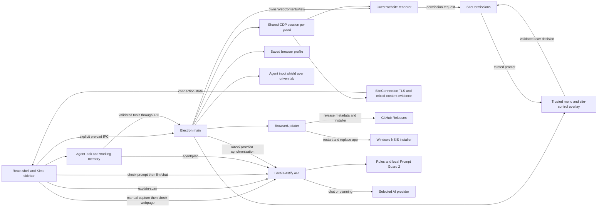

# Orbit Browser Architecture

This document describes the current working-tree implementation of the project **Prompt Injection Defense in an AI-Native Browser**, reviewed on **19 October 2026**. The desktop product is named **Orbit**, its frontend package is `orbit-browser` (currently version **1.0.5**), and its assistant is **Kimo**. Some package, storage, and window names still use PromptGuard or Prompt Defense (for example the `prompt-defense-browser` user-data folder). Its React interface provides browser tabs, address-bar website permission and connection controls, a native browser menu with history, downloads, bookmarks, settings and update controls, a manual webpage scan with plain-language explanations, AI chat, provider settings, and autonomous Agent Mode. A local Node.js/Fastify service performs prompt-injection classification and connects to a user-selected AI provider. A Windows x64 NSIS installer bundles the browser, backend, production dependencies, and local detection model; the application also implements an update client and GitHub release workflows.

Descriptions below separate behavior that runs from helpers that exist but are not wired in. The project implements manual webpage detection and a direct-chat-prompt gate. It does **not** automatically classify the page state, tool observations, or user goal supplied to Agent Mode, so protecting autonomous browsing is a project objective, not a property the code enforces end to end.

## Chapter 1 — System Boundaries

Orbit runs three application-controlled parts, with external websites executing in separate Chromium guest renderers. Each Orbit window has its own shell renderer and tab views, plus one transparent overlay view for browser menus:

| Part | Implementation | Main responsibility |
| --- | --- | --- |
| Electron main process | frontend/electron/main.ts, browserUIController.ts, sitePermissions.ts, siteConnection.ts, browserUpdater.ts | Owns the application windows, guest tabs, trusted overlay, saved browser profile, downloads, website permission policy, connection evidence, IPC handlers, CDP sessions, agent input shield, file picker, page-frame capture, provider settings, packaged backend lifecycle, and update checks/downloads/installation. |
| React renderer | frontend/src/App.tsx (welcome screen), frontend/src/components/BrowserShell.tsx (the browser itself, loaded as its own chunk) and frontend/src/components/ | Renders the browser controls, scan reports, chat, provider settings, and Agent Mode; keeps tab and UI state. The same bundle also renders the browser-menu overlay when loaded with `?surface=browser-overlay`. |
| Local backend | backend-node/src/server.ts and backend-node/src/app.ts | Serves the /api/v1 HTTP API on 127.0.0.1:8000 by default; classifies text, builds agent plans, and calls AI providers. |

The renderer calls Electron main through the API exposed by frontend/electron/preload.ts. The renderer and Electron main also call the local backend over HTTP. Browsed websites live in separate, main-owned WebContentsView instances; their page objects are not part of the React DOM.

The principal flows cross those boundaries as follows:

| Flow | Path through the implementation |
| --- | --- |
| Manual page scan | Toolbar in React → BrowserWebView handle → preload scanWebview → Electron CdpInspectionService → backend /security/check-webpage → webpage analysis drawer. |
| Scan explanation | Analysis drawer → backend /security/explain-scan → active provider (or built-in local summary) → summary section in the drawer. |
| Browser menu | Toolbar menu button → preload browserUI → BrowserUIController → transparent overlay view (React, Radix) → profile store (history, bookmarks, downloads, settings). |
| Chat | AI sidebar → backend /security/check-prompt → backend /llm/chat → active provider gateway → chat message in the sidebar. |
| Agent action | AgentTask in React → backend /agent/plan → frontend tool/approval handling → preload runtimeInvoke → Electron BrowserRuntime → guest tab through CDP, while an input shield covers the driven tab. |
| Provider configuration | Settings/model picker → preload providers → main-process ProviderSecureStore → local backend candidate tests or provider synchronization. Ordinary readback returns masked metadata. |
| Application update | Scheduled check or About Orbit → BrowserUpdater → GitHub release feed → user-requested installer download → checksum verification → restart/install lifecycle. |
| Website permission | Guest request → Electron session permission handlers → SitePermissions origin/document checks → owning window's trusted overlay → user Allow/Block → validated callback and in-memory decision. |
| Connection status | Guest Chromium/CDP network and security events → SiteConnection → BrowserUIController → owning shell's address-bar indicator and overlay connection explanation. |

The local classifier and the selected generative model have different roles. Prompt Guard 2 detects injection; the selected provider answers chat questions and plans agent actions. Calling the planner does not invoke the classifier. Scan explanations use the selected provider only to describe a finished scan; they never change its verdict.

## Chapter 2 — Repository and Entry Points

| Path | Implemented role |
| --- | --- |
| frontend/electron/main.ts | Electron startup, multi-window and guest-tab ownership, popup handling, IPC, shared CDP sessions, page-frame capture, provider synchronization. |
| frontend/electron/browserUIController.ts, browserProfileStore.ts, browserUITypes.ts | Browser menu overlay view, keyboard shortcuts, zoom, downloads (including the current session's download list for agent uploads), window commands, and the persisted history/bookmarks/settings profile. |
| frontend/electron/agentInputShield.ts | Transparent view that blocks the user's own input on a tab while the agent drives it. |
| frontend/electron/backendProcess.ts | Starts, health-polls, and stops the compiled backend in packaged and end-to-end runs. |
| frontend/electron/browserUpdater.ts | Owns update state, scheduled and manual checks, verified downloads, installation hooks, and the previous-runtime record. |
| frontend/electron/sitePermissions.ts | Central Electron-session permission handlers; exact-origin and document validation, separate permission kinds, session decisions, prompt deduplication, and cancellation. |
| frontend/electron/siteConnection.ts | Per-guest connection tracker using the shared CDP session, committed-document TLS evidence, certificate errors, mixed-content signals, and inspection availability. |
| frontend/electron/preload.ts | Exposes window.electronAPI to the renderer. |
| frontend/electron/browserRuntime/ | Typed runtime contract, CDP session registry, semantic state builder, element resolver, input dispatch, waits, verification, field probe, file-chooser interception, advanced guest-page tools, and visual overlay. |
| frontend/electron/cdpInspectionService.ts | Captures page content channels for the manual scanner and the runtime's security-snapshot command. |
| frontend/electron/providerSecureStore.ts | Saves provider metadata and safeStorage-encrypted keys, keeps temporary keys in main-process memory, migrates legacy records, resolves credentials for candidate tests, and syncs usable configurations to the backend. |
| frontend/src/App.tsx | Welcome screen; loads and mounts the browser shell when the user starts. |
| frontend/src/components/BrowserShell.tsx | Browser shell, tabs, navigation, bookmark bar, assistant state, and manual scan orchestration. The assistant, provider settings modal, and report drawers are separate chunks, mounted on first use (see frontend/src/utils/deferredComponent.ts). |
| frontend/src/components/ | Browser UI, AI sidebar, scan results and summaries, report drawers, agent controls, provider settings, the Liquid Glass surface components, the Kimo mascot, and BrowserOverlay (menu, history, downloads, bookmarks, settings panels). |
| frontend/src/components/SiteControlsPopup.tsx | Address-bar permission and connection dialogs inside BrowserOverlay, with requested-feature labels, Allow/Block controls, origin display, and connection explanations. |
| frontend/src/services/ | HTTP clients, page-content adapter, agent loop, tool mapping, approval policy, activity labels, task working memory, temporary session memory, and unused browser-memory/recovery helpers. |
| frontend/src/utils/ | Deferred component loading, model-capability heuristics, browser-side DOCX extraction, scan-progress estimation, and the spring, frame-loop, dock, and page-backdrop helpers behind the glass UI. |
| frontend/kimo-preview.html, src/kimo-preview.tsx, kimo-shoot.mjs | Development-only gallery for the Kimo mascot and glass components, and a Playwright script that screenshots it. Not part of the packaged app. |
| backend-node/src/app.ts | Builds Fastify, configures CORS and errors, waits for classifier initialization, and registers routes. |
| backend-node/src/routes/ | Health, security, chat, agent planning, and provider endpoints. |
| backend-node/src/schemas/ | TypeBox schemas for security, analysis details, chat, agent, and provider payloads. |
| backend-node/src/services/ | Text preparation, detectors, feature explanations, scan summaries, the security event store, planner, tool validation, document text extraction, provider manager, and gateways. |
| backend-node/src/core/ | pino logging and security constants (rule indicators and the AI-directed cue pattern). |
| backend-node/src/dl/ | Local Prompt Guard 2 loading and ONNX inference. |
| backend-node/dl_models/prompt_injection_model/ | Model configuration, tokenizer, provenance in SOURCE.md, and locally provisioned onnx/model.onnx weights. Weights are Git-ignored. |
| frontend/scripts/ | Development launcher, production backend staging, and standalone validation scripts. |
| frontend/electron-builder.yml | Application identity, ASAR contents, unpacked backend/model resources, and the GitHub update-feed configuration. |
| installer/build.mjs, installer.config.mjs, model.mjs | Installer entry point, Windows x64 NSIS configuration, model hash verification/download and staging, and bundled-runtime metadata. Output goes to installer/dist/. |
| installer/nsis/, installer/assets/, installer/tools/ | Setup wizard hooks, app/setup artwork, license text, model license/notice, and artwork generation. |
| installer/release-runtime.mjs | Reads the runtime versions recorded in installer/dist/latest.yml for release notes. |
| .github/workflows/release.yml, electron-update.yml | Windows release validation/draft upload and weekly tested Electron-upgrade proposals. |
| backend-node/test/, frontend/test/, frontend/e2e/ | Backend Vitest, provider storage/client Vitest, and desktop Playwright tests, including update and packaged-app fixtures. |
| docs/ | Feature notes; browser-menu-implementation.md documents menu/profile/download design, auto-update.md documents update/release behavior, and site-controls.md documents website permissions and connection indicators. |

The backend is TypeScript/Fastify (ESM). The frontend is TypeScript/React/Electron built with Vite.

## Chapter 3 — Application Startup and Process Communication

In development, frontend's npm run dev invokes scripts/run-dev.mjs, which starts the dev:processes script. That script builds and starts the backend, starts Vite on localhost:5173, watches Electron TypeScript, waits for Vite and the backend health endpoint, and launches Electron. With PROMPT_DEFENSE_DEV=true, Electron does not spawn a second backend.

In packaged or end-to-end runs, frontend/electron/backendProcess.ts starts the compiled backend with Electron's executable in Node mode (`ELECTRON_RUN_AS_NODE=1`), sets `APP_ENV=production` and `PORT=8000`, polls /api/v1/health for up to 15 seconds, and stops the child process when the app quits. Electron starts this work concurrently with window creation: the welcome screen does not wait for backend readiness. After the startup promise resolves, main attempts provider synchronization. Backend startup is best effort; health timeout or child failure is logged and does not prevent the window from opening. There is no automatic backend restart supervisor.

backend-node/src/server.ts binds Fastify to 127.0.0.1. Frontend HTTP clients, main-process provider operations, and health polling target 127.0.0.1:8000/api/v1, so changing `PORT` or `API_V1_PREFIX` alone does not update their targets. `env.ts` loads dotenv from the process working directory, but resolves `MODEL_DIR` against the backend package root derived from its own module location. The default therefore reaches backend-node/dl_models/prompt_injection_model in the checkout and resources/backend/dl_models/prompt_injection_model in a packaged build, independently of the launch directory. An absolute `MODEL_DIR` override remains absolute. The child spawn does not set an explicit working directory or model path.

The preload bridge exposes tab creation/navigation/history/reload/stop, tab information, events and bounds, active-tab and agent-lock operations, popup lifecycle events, page-frame capture (`captureBackdrop`, `captureFrame`), manual page capture, typed browser-runtime invocation, provider storage/model-list/connection-test operations, and a `browserUI` object for the menu, profile, downloads, zoom, window commands, updates, and site controls. Update operations are `updateState`, `checkForUpdates`, `downloadUpdate`, and `installUpdate`, with pushed state through `onUpdate`. Site operations are `siteAnchor`, `connection`, `onConnection`, and `decidePermission`. Overlay state includes optional permission/connection details and can be cleared with a null snapshot; focus restoration distinguishes the site-control and menu buttons. It exposes no generic IPC invocation function. Electron main resolves the sending window with `requireShell`, which accepts only the main frame of a registered shell renderer, and `requireTabView` additionally requires that the tab belongs to that window. The runtime also requires a registered target before it can act on a tab. The `browser-ui:*` handlers apply a similar frame check through the controller, including update operations. Permission decisions additionally require the owning overlay's main frame, the displayed prompt ID, the active target, and matching window ownership. Provider IPC handlers do not perform the same sender check.

Setting `ORBIT_USER_DATA_DIR` moves Electron's user-data directory away from the default prompt-defense-browser folder; the browser-menu tests use it for isolation.

Main creates BrowserUpdater alongside BrowserUIController and starts update scheduling after the first window opens. Explicit update installation calls `stopBackend()`, which releases the child reference, requests termination, and waits for exit or a three-second timeout before the installer replaces the executable and native modules. An installer-launch error triggers another backend-start attempt. This is separate from general crash recovery; it is not a backend restart supervisor, and a stop timeout does not prove the child exited.

## Chapter 4 — Browser Shell and Tabs

BrowserShell.tsx owns the visible tab list, selected tab, address bar state, scan state, assistant state, and active runtime target ID. Bookmarks are held in the main-process profile and pushed to the shell as snapshots. BrowserWebView.tsx normally creates a guest tab through browser:create-tab when mounted and closes it when unmounted. For a site-created popup, it instead adopts the existing webContents ID supplied by main. The component keeps that ID as its handle; Electron main keeps the matching WebContentsView.

The browser toolbar offers address/search submission, back, forward, reload/stop, bookmark toggling, manual Scan, and the AI sidebar. The address bar also has a connection-status button that anchors trusted site-control popups. The shell keeps connection state associated with its tab and guest target, subscribes to main-process updates, and uses the initial URL state until matching evidence is available. It ignores late initial reads after a pushed update and displays a stored state only when its tab and URL match the active page. The shell also provides new and close tab behavior, and persists assistant width in renderer localStorage. Closing the last tab closes that window. The toolbar menu button and a download indicator open overlay panels, and the bookmark bar can be hidden from Settings. The new-tab/home screen is rendered by React. Outside Electron, BrowserWebView renders an iframe preview; the main-process browser runtime is available only in Electron.

Main sends loading, navigation, title, favicon, zoom, and load-failure events back to the renderer. BrowserWebView reports its React container bounds to main so the native guest view can be placed over that area. It gives the view zero bounds when its tab is inactive, the home screen or an error is shown, or a drawer/modal or resize interaction must cover it.

Only main-frame load failures other than aborted navigation replace the visible page with an error. The failure event includes the attempted URL, so a blocked certificate connection remains associated with the correct address and indicator. Successful navigation clears the previous load error; subframe failures do not replace the main document.

BrowserToolbar and BrowserWebView implement the main browser surface; BrowserWebView also reports the active tab and the page zoom to main. AiAssistantSidebar hosts Chat and AgentModePanel. WebpageAnalysisDetailsPanel and PromptAnalysisDetailsPanel display separate detector results inside a shared ReportDrawer; ProviderSettingsModal manages AI connections. These components receive state and callbacks from the shell rather than owning guest webContents directly.

### Liquid Glass surfaces and page frames

The sidebar, report drawers, settings modal, and switches are drawn with `LiquidGlass.tsx` and `liquid-glass.css`: an SVG filter pipeline (refraction, chromatic edge, rim, blur/saturation) with spring-driven pointer response (`utils/spring.ts`, `utils/frameLoop.ts`). GlassSwitch and GlassModeSwitch build toggles on it.

A native guest view cannot sit under a DOM element, so the glass needs a picture of the page. `usePageBackdrop.ts` asks main (`browser:capture-backdrop`) for a small JPEG of the half of the guest page beside the assistant panel, with its mean luminance, every 2.5 seconds and shortly after loads, but only while the panel is showing and the window is in front. On the home page it samples the shell's own page area instead. When a report drawer or the settings modal opens, the shell hides the guest view and shows a single frame from `browser:capture-frame` in its place, waiting at most 200 ms for it. Both handlers check the sender with `requireShell`/`requireTabView`, and the frames stay in the renderer as data URLs.

### Popup authentication, downloads, and browser lifetime

Guest `window.open` and target-blank requests are routed into the main tab strip by `setWindowOpenHandler().createWindow`. Main adopts Electron-supplied `options.webContents` when present and returns that exact object, retaining opener relationships and avoiding `Invalid webContents`. The popup uses the opener's Electron session, isolated context, sandbox, and disabled Node integration. If Electron supplies no child contents, main loads the requested URL with available referrer and POST body. Popup creation/closure events synchronize the tab strip with the guest lifecycle.

Normal tabs use the default Electron session; popups explicitly share their opener's session. Chromium owns cookies and authentication state. This is separate from agent session memory. The implementation is meant to keep sign-in across tab navigation and refresh. The local popup/cookie regression test does not show that every live OAuth provider works.

`webviewContextMenu.ts` provides native navigation, save, inspection, and DevTools actions, including Save Link As and Save Image As, which always ask for a location; Open in New Window and View Source open a plain window without the preload. Downloads on `session.defaultSession` are tracked by BrowserUIController (see the next subsection). The agent has no download tool; it can start a download only by clicking a link or button on the page. Tabs are held in renderer/main memory, and the previous tab list is not restored after restart.

### Browser menu overlay, saved profile, and windows

The toolbar menu opens a transparent child `WebContentsView` that BrowserUIController stacks above the guest tabs, so a website cannot cover it and the page keeps running underneath. It loads the renderer with `?surface=browser-overlay` and renders New tab, New window, History, Downloads, Bookmarks, Delete browsing data, Zoom, Print, Settings, About, and Exit using Radix menu and dialog primitives. The overlay view uses context isolation, no Node integration, and `sandbox: false`, and it blocks navigation and window creation. Ctrl shortcuts (new tab, new window, history, downloads, bookmarks, bookmark page, address bar, close tab, tab switching, zoom, print), Alt+F, and F11 are handled by `before-input-event` on the shell, the overlay, and every guest.

BrowserProfileStore keeps up to 10,000 history visits, 5,000 bookmarks, and 500 download records, plus settings (download folder, ask where to save, bookmark-bar visibility, default zoom), in `browser-profile.json` under userData. Writes are debounced and saved by temporary file and rename. The profile is shared by all Orbit windows, and legacy localStorage bookmarks are imported once. Only http, https, and file URLs are accepted into it. Page zoom is remembered per origin for the running session; only the default zoom is saved.

Downloads use Electron's `will-download`, with sanitized filenames, non-overwriting names, an optional per-download save dialog, and progress, pause, resume, cancel, retry, open, and show-in-folder controls. Delete browsing data filters history and download records by time range, but Electron clears cookies, site storage, and cache for the whole session regardless of range.

Each window owns its tabs (`tabOwners`); popups join their opener's window. Reloading or crashing a shell renderer releases that window's tabs and shields. These are browser features for the user. The planner has no tool for the profile or the menu; only the current session's completed downloads reach it, as upload sources (Chapter 5).

### Address-bar website permissions

BrowserUIController owns one SitePermissions instance, installs Electron's permission-check and permission-request handlers once for each attached browsing session, and attaches both ordinary and popup guest tabs. Requests are shown by SiteControlsPopup inside the existing trusted overlay WebContentsView, above native website content. The address-bar button reports its screen anchor on layout changes; dialogs return keyboard focus to that button when closed. The Block button receives initial focus. Shell code can open connection details, but it cannot use the generic panel API to manufacture a permission prompt or submit an Allow decision; permission decisions must come from the owning overlay.

Decisions are stored only in main-process memory, keyed by the exact HTTP(S) origin, including scheme and port, and the permission kind. Camera and microphone are distinct; combined media requests list both. Clipboard read and sanitized clipboard write are independent. Other recognised permission kinds are location, notifications, fullscreen, pointer lock, idle detection, MIDI, MIDI system messages, audio-output selection, keyboard lock, and window management, where Electron emits a request. The dialog identifies the requesting origin and the requested capabilities and states that the choice lasts for the Orbit session. Decisions are shared across owned tabs for the same origin and permission, but are not written to browser-profile.json or restored after restart.

The handler requires an owned, live guest, a main-frame request, and agreement between the top-level origin and every supplied requesting/security/embedding origin. It rejects malformed or opaque origins, URLs containing credentials, unsupported permissions, worker/null-content requests, and requests from subframes, including same-origin subframes. A new prompt must belong to the active tab in a ready window. Device permissions and display capture are denied by their installed handlers; filesystem and storage-access permissions have no grant path in this implementation.

Each prompt has a random identifier and is bound to the guest's main-frame identity and document generation. Identical overlapping requests from that document share a prompt with at most 16 callbacks; conflicting or excess requests are denied. Decisions recheck the prompt ID, origin, document identity, active target, and window ownership. Dismissal by close/Escape/outside click, tab switching, or panel replacement denies a pending prompt. Document replacement, guest destruction, and renderer failure cancel pending requests; navigation-commit cancellation also catches requests made by the outgoing document while navigation was in flight. Pending entries are removed before callbacks run, and stale decisions are ignored. These controls apply to requests Electron exposes; operating-system privacy controls still apply.

### Verified connection status and certificate handling

Main calls `attachSiteControls` for every guest alongside shared CDP attachment. BrowserUIController creates a SiteConnection tracker per guest and pushes connection changes only to its owning window; an open connection dialog is refreshed as evidence changes. Switching targets closes site popups and publishes the newly active target's state. These are Electron/main-process controls; no Fastify endpoint or generative AI is used to decide connection status.

| Connection state | Address-bar/dialog behaviour |
| --- | --- |
| internal | Identifies an internal/local page without claiming a verified website connection. |
| http | Shows Not secure immediately and explains that the connection is not encrypted. |
| checking | Waits for Chromium connection evidence for an HTTPS navigation. |
| encrypted | Reports a verified encrypted connection after matching committed-document TLS evidence. |
| insecure | Warns about Chromium-reported connection issues or loaded insecure content. |
| certificate-error | Shows a certificate warning and retains rejection of the invalid connection. |
| unavailable | Reports that the connection could not be verified, including inspection loss or relevant load failures. |

A URL beginning with https is not sufficient for the encrypted state. SiteConnection correlates the committed main-frame loader with its `Network.responseReceived` document response and requires Chromium's secure status, TLS protocol, and certificate issuer evidence. It observes the Page, Network, and Security domains through the existing CdpSession rather than creating another debugger attachment. HTTP resources or child frames actually loaded by an HTTPS document, and Chromium insecure/neutral security events, downgrade the state. Certificate errors take precedence over later secure-looking responses until the next document navigation. Same-document navigation preserves the established evidence, while debugger detachment or renderer loss changes the status to unavailable.

The Electron certificate-error callback returns false. Certificate validation remains enabled, and no certificate exceptions or bypass switches are added. The connection dialog explains the result in plain language and distinguishes an encrypted connection from a guarantee that the website itself is trustworthy. Detailed implementation and verification notes are in docs/site-controls.md.

### About Orbit and update controls

About Orbit displays the running Orbit, Electron, Chromium, and Node versions, plus the model attribution "Built with Llama". BrowserUpdater pushes state to shell and overlay renderers through BrowserUIController. An orange toolbar-menu marker indicates an available update; a green marker indicates a downloaded update. The menu offers Update Orbit or Restart to update Orbit, and About shows release/runtime versions, progress, errors, and the previous version after an upgrade. Restart confirmation warns that open tabs will close because the tab list is not restored. The distribution and update lifecycle is detailed in Chapter 13.

## Chapter 5 — CDP Capture and Browser Actions

Each guest webContents has one CdpSession in CdpSessionRegistry. The manual content inspector, agent BrowserRuntime, and SiteConnection tracker share that attachment because Electron permits one debugger attachment per webContents. The session enables requested CDP domains, fans out protocol events, and attempts to reattach after a detach. Connection tracking subscribes to Page, Network, and Security evidence on that same session.

CdpInspectionService captures the main frame and available child frames with an isolated-world collector. It reads visible text, hidden text, comments, metadata, form values, accessibility text, open shadow-root text, inline scripts/styles, generated CSS text, external script/stylesheet URLs, and observed source-map references. It also reads a DOM snapshot. It does not fetch external script bodies, external stylesheet bodies, or source-map files. Main-frame channels come from the main frame; child-frame visible/hidden/shadow text is combined into iframe_content rather than merging all child-frame channels. Closed shadow roots and unavailable frames can be omitted.

Capture is bounded: the frame collector normally caps each channel at 30,000 characters, aggregate clipping at 60,000 characters, and source-map references at 100 entries with 2,000 characters per entry. Because of these caps and best-effort collection, a clean result covers only what was captured, not every byte of the website. Source-map observations are held per attached guest session; capture does not explicitly reset them on each navigation.

The agent BrowserRuntime accepts commands through the runtime contract in frontend/electron/browserRuntime/runtimeContract.ts, mirrored in frontend/src/types/browserRuntimeTypes.ts. Its page-state builder turns accessibility-tree data into a capped PageStateSnapshot containing named controls, element IDs, values and control states, nearby text/container context, focus, dialogs, validation errors, selection, URL, title, capture time, a truncation flag, the session's available downloads, and any file chooser the page has opened. It caps interactive elements at 500, dialogs at 25, and validation issues at 50; the backend planner renders at most 450 elements. Element handles stay inside main and are refreshed on state extraction or invalidated by runtime navigation. They are not durable identifiers across planning rounds.

Runtime commands include target description, navigation, click, fill, type, key press, scroll, upload, navigation/DOM waits, screenshot, semantic state extraction, a security snapshot, visual overlay, JavaScript evaluation, selector bounds, direct mouse events, drag, and virtual-table extraction. The runtime resolves controls to CDP nodes/coordinates, dispatches input through CDP, settles the page, and returns action verification where applicable. `fieldProbe.ts` supports `fill` and `upload`: it reads, without assigning a value, which field has focus (following open shadow roots and same-origin frames) and what it holds, so a fill is judged by whether the text landed. It has a recipient-field variant for token inputs that turn text into chips. A field whose content cannot be compared, or a cross-origin frame, is reported as unverifiable rather than as success. These are Chromium CDP input events rather than operating-system input automation. The planner registry accepts absolute HTTP(S) navigation URLs; the lower-level runtime also accepts the `about:` scheme. These checks do not inspect later redirects or link destinations.

`advancedBrowser.ts` evaluates planner-supplied JavaScript in the registered guest page with a default 5-second evaluation timeout, a maximum 15-second timeout, and JSON output capped at 100,000 characters. Selector bounds support open-shadow-root selectors using `>>>`. Mouse coordinates are guest-viewport CSS coordinates and are validated against the viewport. Drag interpolates a left-button gesture and releases the button in a finally block. Virtual-table extraction reads recycled rows afresh, deduplicates stable IDs, checks contiguous row indices, and returns row evidence, missing indices, a completeness flag, and TSV. It defaults to 20 rows and limits requests to 100 rows, 20 columns, 100 wheel events, and a 25-second collection deadline. These observations enter working memory and trigger replanning before dependent actions.

Upload never takes a path from the planner. The planner names the file input or the control that opens it (an "Attach" button driving a hidden input), plus optionally a download id. Download ids (`d1`, `d2`, …) come from the page state's `downloads` list: completed downloads from the current app session whose file is still on disk (`BrowserUIController.sessionDownloads`), bound per extraction like element ids and re-checked before use. Earlier sessions' downloads are not offered. Without a download id the user chooses files in an Electron dialog. Main applies the paths with `DOM.setFileInputFiles`; the paths never leave the main process.

While the agent holds a tab (the same span as the input shield), `fileChooser.ts` turns on `Page.setInterceptFileChooserDialog`, so a page that calls `input.click()` from its Attach button gets no OS dialog, which the agent could not operate. Chromium reports the waiting input instead; it appears in the page state as `fileChooser`, and the next `upload` fills it. `upload` given a non-input control clicks it itself with interception switched on for that click. Outside agent tasks the user's own uploads use the normal OS dialog. The runtime offers no terminal, general filesystem access, or email integration.

Verification compares pre/post URL, accessibility structure, scroll position, field value, checked state, and expanded state as appropriate. DOM settling polls the accessibility tree at 150 ms intervals until two successive stable comparisons; post-action settling also attempts a short network-quiet wait. This confirms that the page is ready and that something changed; it does not prove the task succeeded or that the page is free of injection. Screenshots and security capture are available runtime commands but are not registered planner tools.

## Chapter 6 — Backend API

backend-node/src/app.ts registers these route groups under the configured prefix, /api/v1 by default:

| Method and path | Current behavior |
| --- | --- |
| GET /health | Reports health, backend/runtime versions, model load status, classifier mode, and model precision. |
| POST /security/check-prompt | Classifies a nonempty direct prompt and returns a detailed decision. |
| POST /security/check-webpage | Classifies nonempty captured webpage channels separately and returns a detailed decision. |
| POST /security/explain-scan | Takes a finished scan's analysis details and returns a three-paragraph plain-language summary, written by the active provider or by a built-in local fallback. |
| GET /security/events | Returns recent security-analysis events from an in-memory store. |
| POST /llm/chat | Rechecks the supplied prompt, then sends approved chat data to the active provider or returns the no-provider response. |
| POST /agent/plan | Uses the active provider to produce and validate an action queue for the given goal, working memory, and page state. |
| GET /agent/tools | Lists the planner's registered tools and parameter metadata. |
| GET /providers/presets | Returns provider presets. |
| POST /providers/models and POST /providers/test | Fetches models or tests candidate provider credentials. |
| GET, POST, DELETE /providers/active | Reads, sets, or clears the provider active in backend memory. |
| POST /providers/configured | Loads configured providers into backend memory for fallback operations. |

Fastify uses TypeBox request/response schemas on the principal security, chat, agent, and provider routes, with a 50 MiB request-body limit. app.ts waits for local classifier loading to finish, successfully or in fallback mode, before registering routes. Request validation failures use status 422 and a `{detail}` body; empty prompts/goals or scans without classified content use 400, unknown routes use 404, and unhandled server failures use an Internal Server Error detail. Agent provider failures use 502. The explain-scan response is `{summary, source, provider?, model?, note?}`.

## Chapter 7 — Prompt-Injection Detection

The manual security routes use analyzeText in backend-node/src/routes/security.routes.ts. It preprocesses input, splits each source into overlapping chunks, calls promptClassifier.classifyMany once for the batch, and aggregates the result. Defaults are 800 characters per chunk with 100 characters of overlap. A single malicious chunk makes the overall decision disallowed. Direct prompts are chunked after preprocessing; webpage channels are chunked from their original channel text to retain source evidence. Preprocessing strips HTML with cheerio where applicable, lowercases, and normalizes whitespace. Its token_count is a whitespace-word count, not the transformer tokenizer count; Unicode NFKC normalization is not implemented.

promptClassifier runs the rule detector and, when loaded, the local Prompt Guard 2 classifier. A chunk is malicious when either detector matches, subject to the webpage corroboration rule below. The rule detector reports matched categories and phrases; the model supplies a MALICIOUS score. Results carry detector source, confidence, matched patterns, and per-chunk explanations for the UI. The response also contains preprocessing and chunking metadata, feature evidence, a final rationale, classifier mode, and model precision.

The five rule categories in backend-node/src/core/securityConstants.ts are override_instructions, jailbreak_attempt, hidden_instruction, system_prompt_reveal, and data_exfiltration. RuleBasedDetectorService uses whole-word matching at alphanumeric term boundaries. Common short or ambiguous terms, including dan, jailbreak, and upload to, count only when instruction-like wording appears within 160 characters. A second set of shape-based regular expressions per category (for example an override verb aimed at instructions, an order to reveal the system prompt, or an order to hand over tokens or cookies) catches reworded attacks that exact phrase lists miss. Each requires both a verb and its target.

### Model-only chunks and webpage corroboration

For a chunk flagged by the model alone, with no rule evidence, `inspectModelOnlyChunks` re-scores the chunk as sentences of at least 20 characters and as adjacent sentence pairs, in one extra inference pass. The highest-scoring passage becomes the excerpt shown in the report.

The same pass decides whether the hit is credible on **webpage scans**. Prompt Guard 2 gives ordinary imperative page copy ("Never start a document from scratch") scores of 0.98 and above, the same as a real attack. A model-only webpage chunk therefore stays malicious only if some passage the model flags by itself also matches `AI_DIRECTED_CUE_PATTERN` in securityConstants.ts. That pattern looks for wording that addresses an AI, refers to its instructions or rules, targets the user or their data (credentials, cookies, tokens, keys, URLs), or asks for secrecy. It is intentionally much broader than the rule indicators; it is not a detector of its own. A chunk whose score appears only in the context of its neighbours, with no flagged passage on its own, is not corroborated either.

An uncorroborated chunk is labelled benign with an "ordinary page text" reason that quotes the model score. Rule matches, DL inference errors, and errors in the re-score pass keep the malicious verdict (fail closed). **Direct prompts keep the model's raw verdict**, since Prompt Guard was built for that input.

### Model lifecycle and thresholds

The ONNX model loader reads local fp32 Llama Prompt Guard 2 22M artifacts from MODEL_DIR through @huggingface/transformers and onnxruntime-node. Repository model configuration identifies a DeBERTa-v3-xsmall backbone and BENIGN/MALICIOUS labels; SOURCE.md documents provenance. The model pipeline is cached once per backend process and remote model loading is disabled. If it cannot load, the service reports rule_based_fallback and continues with rules. If an already-loaded model throws during inference, the classifier marks the affected batch malicious and records an error instead of treating it as clean.

The model has a 512-token context window. Inputs exceeding it are split into overlapping subchunks, starting at 400 characters and shrinking as needed to a minimum of 100, before batched inference. The maximum MALICIOUS score over a chunk's subchunks becomes its model score. Forward passes use up to eight sequences and a 15-second timeout per batch. The tokenizer also has its maximum length pinned to 512. This keeps text inside a classifier input from being silently truncated, but it cannot recover content that was skipped or clipped during capture.

DL_MALICIOUS_THRESHOLD (default 0.5) determines when the model flags a chunk. Risk labels are separate: confidence at least 0.85 is high, at least CLASSIFIER_THRESHOLD (default 0.7) is medium, otherwise low. CLASSIFIER_THRESHOLD is not the model's allow/block threshold. The reported confidence includes rule heuristics and fixed benign-response values; it is not a measured accuracy metric. The security endpoints store verdict summaries in securityEventStore, limited to the 50 latest events and returned newest first. The /llm/chat final check calls the classifier directly and does not create an analyzeText event.

## Chapter 8 — Manual Webpage Scan and Report

The toolbar Scan action is implemented in BrowserShell.tsx. It freezes the page frame, asks the active BrowserWebView handle to capture its guest page through security:scan-webview, opens the webpage analysis drawer, and sends the captured object to POST /security/check-webpage. Prompt analysis and webpage analysis have separate renderer state so their results are not mixed.

While the request runs, the drawer shows a progress bar with elapsed time (`utils/scanProgress.ts`). The backend sends no progress events, so the bar is an estimate: the expected duration comes from the captured channel sizes (about 150 ms per 700 new characters, at least 10 seconds). The bar eases to 90% over that time and then creeps toward 99.9% without stopping. The shell shows the result no sooner than 10 seconds after the scan starts, then holds the bar at 100% for 450 ms before the report replaces it. Closing the drawer aborts the scan through an AbortController: the renderer cancels the HTTP request and its timers and discards the result, though the backend may finish the work it has already started.

The backend classifies **13 channels** (`MANUAL_SCAN_CHANNELS`), made up of 11 core channels and two extended reference channels. It preserves the channel name on each chunk so the report can identify where a finding came from.

| Channel | Captured material |
| --- | --- |
| visible_text | Main-frame body innerText. |
| hidden_text | Text from elements hidden by selected attributes or computed styles. |
| html_comments | DOM comment contents. |
| meta_tags | Meta content attribute values. |
| input_values | Input, textarea, select, and option values/text. |
| aria_text | Accessibility-related attributes and an accessibility-tree text dump. |
| iframe_content | Available child-frame visible, hidden, and open-shadow-root text. |
| shadow_dom_content | Text in accessible open shadow roots. |
| inline_javascript | Inline script text. |
| css_content | Inline style text and external stylesheet URLs. |
| css_generated_content | Computed before/after pseudo-element content. |
| external_javascript | External script URLs, not fetched script bodies. |
| source_maps | Observed script-URL → source-map-URL references, not source-map bodies. |

page_title and url accompany capture but are not classified channels. Captured dom_snapshot_content is deliberately excluded: it is an unstructured string table whose readable text the visible, hidden, and aria channels already cover.

Both reports include a summary section. ScanSummarySection calls POST /security/explain-scan with the structured analysis details. When a provider is active, scanSummaryService sends it only a digest (verdict, detector outcomes, at most eight flagged chunks, each excerpt capped at 400 characters and JSON-quoted, and a count of model-only signals cleared by the corroboration rule) under a system prompt that calls the data untrusted, with a 40-second timeout. With no provider, or on failure or an empty answer, it returns a built-in local summary and a note saying why; the local summary for a clean page also mentions cleared model-only blocks. The summary explains the verdict and never alters it, but excerpts of flagged text do leave the machine when a provider is active.

The manual scan produces a report for the user. It does not stop ordinary browser navigation or scan pages as they load. Capture and classification happen only when the user invokes Scan.

## Chapter 9 — AI Chat

AiAssistantSidebar.tsx provides chat sessions and Agent Mode in the same sidebar. Chat sessions, including message-associated attachment data, are stored in renderer localStorage on a best-effort basis. A user can optionally attach the active page; the sidebar then captures the page and passes its visible_text, title, and URL as chat context. LlmProviderManager includes at most 25,000 characters of page context and the last 20 history messages.

On chat submission, the sidebar calls POST /security/check-prompt for the user's typed prompt. It calls POST /llm/chat only if that response allows the prompt. /llm/chat classifies the prompt again and rejects a malicious result with HTTP 403 before forwarding. llmProviderManager builds a provider message from its system instruction, recent history, optional page context, attachments, and the user request. With no active provider, chat returns an explicit no-provider response; Agent Mode planning instead returns unavailable.

The checks cover only the prompt field. The attached page text, prior history, and file attachments are not run through the webpage or prompt scanner on this chat path, and the final /llm/chat check also classifies only the prompt. The prompt analysis panel can request an explain-scan summary of the prompt's verdict. A manual Scan result does not gate later chat messages.

### Attachments and model selection

PromptInputBox stages images, PDF, DOCX, and text files. Text and DOCX content can be extracted in the renderer; backend documentTextExtractor also implements basic DOCX ZIP/XML and PDF text-stream extraction, with UTF-8 fallback. This is best-effort parsing rather than a complete document/OCR engine. Non-image attachment text is added to the user message with a 50,000-character cap per file; provider gateways encode image attachments in their respective formats. Native PDF, audio, or video input is not guaranteed for every model.

`modelCapabilities.ts` guesses from the provider and model name whether to enable attachments and when to show compatibility errors; it does not query the provider for capabilities. PromptModelPicker switches the active provider/model used by chat and planning. Gateway model-list requests use 15-second timeouts and completions 40-second timeouts. Provider chat errors are returned as explanatory chat content; planning errors become an HTTP failure for the agent to handle.

## Chapter 10 — Autonomous Agent Mode

AgentModePanel starts AgentTask in frontend/src/services/agentRuntimeCore.ts for the active guest target. On each planning round, AgentTask extracts a semantic page state, updates working memory, and calls POST /agent/plan. The backend planner builds a request for the active AI provider, parses the response, validates tool names and arguments against agentToolRegistry, and returns an action queue with confidence and approval metadata. An unconfigured provider yields HTTP 503; invalid plans yield HTTP 422.

The registered planner catalogue contains **16 tools**:

| Planner tools | Executor and purpose |
| --- | --- |
| click, fill, type, press_key, navigate, scroll, upload, wait | Frontend mapping to main-process browser actions; wait maps to DOM stability; upload takes an optional download id. |
| evaluate, element_bounds, dispatch_mouse_event, drag, extract_virtual_table | Advanced guest-page observation/action commands in advancedBrowser.ts. |
| open_tab | Agent loop calls the shell to create/select a tab and switches its target ID. |
| extract | Agent loop records a planner-supplied finding; it is not a separate automatic DOM scrape. |
| finish | Agent loop records a terminal result and ends execution. |

Backend validation accepts one to four actions per plan, rejects unknown tools/arguments, enforces argument types, current element IDs, and known download IDs, and checks queue coherence. Upload must be alone; nothing follows finish or an advanced observation tool; element-dependent actions and press_key cannot follow navigate. The planner instructions also require replanning after navigate/open_tab. The frontend ends a queue when it changes targets, navigates, receives an advanced observation, encounters a failure, or refuses an action. The prompt instructions ask for more than the validator checks, so they should not be read as mechanically enforced rules.

Executed and recorded loop actions count toward the default **150-step** limit, including finish and loop-handled actions. Not every refusal before execution advances that counter, so separate streak limits stop endless retries. Planner requests have a 45-second frontend timeout; up to 12 consecutive recoverable planning failures are retried with backoff from 500 ms to a maximum of 4 seconds. An unconfigured provider stops the task immediately. Six consecutive guard refusals stop the task. Stagnation detection refuses three matching action/page signatures in a nine-action window, or four matching semantic intents in a ten-action window. Routine observation/scroll tools are exempt from those windows. These limits bound the loop; they do not classify injection.

### Approval behavior and operational limits

The frontend approval policy pauses for upload and for click/key actions whose accessible labels match financial, destructive, or submit-like patterns. Recognized cookie-consent dismissals are exempted. Every upload needs approval; for a download-id upload the dialog names the file and the destination host, otherwise a main-process file picker follows. A declined approval ends the task. These label checks cannot tell what arbitrary JavaScript, coordinate clicks, drags, or every keyboard submission will do, so they are not a general authorization layer.

The backend returns needs_user_confirmation when confidence is below AGENT_MIN_CONFIDENCE (0.6). However, all registered **non-upload tools have a frontend confidence threshold of zero**, including click, navigate, finish, evaluate, and drag, so that backend flag alone does not pause them. Upload has a threshold of 1.0 and requires approval regardless of confidence; an unknown frontend tool would use the fallback threshold of 0.6.

AgentTask checks existing blocked-origin memory only for planned navigate/open_tab URLs. It does not block the initial page, page-triggered popups, link navigation, or redirects based on this memory, and the loop never adds new blocked-origin records.

### Working memory, session continuity, and unused helpers

The backend planner is stateless between requests. Continuity comes from the renderer's AgentWorkingMemory snapshot, supplied on every planning round:

| Layer | Current contents and bounds | Lifetime/use |
| --- | --- | --- |
| Recent action/failure log | Up to 40 completed steps and 20 failures, plus retry count, page URL, invalid element IDs, and a brief previous thought. The planner renders the last 20 steps and six failures. | One AgentTask, in renderer memory. |
| Progress and milestones | Up to 15 checklist items and 40 milestones; the first five milestones and newest entries are retained at the cap. The planner renders the last 30 milestones. | One task, with more durable progress than the rolling step log. |
| Entered-content ledger | Up to 30 entries, with full text retained locally for similarity checks and previews/status in the transmitted snapshot; the planner renders the last 12 entries. | One task; detects duplicate append-style type actions. |
| Findings/observations | Up to 100 findings, including planner notes and serialized advanced-tool observations, labeled as untrusted data in the planner prompt. | One task; can contain website-derived data. |
| AgentSessionMemory | Last five terminated-task summaries, each with goal, status, outcome, final URL, and up to 12 milestones. Goal/outcome are capped at 400 characters. The planner renders only the last three tasks. | Current renderer lifetime; supports follow-up references across tasks. |
| AgentBrowserMemory helper | localStorage schema for up to 50 origins and 30 successful interaction patterns per origin, plus blocked flags. | Persists across restarts; the agent loop reads only the blocked flags. |

Session memory is a structured summary, not a full execution transcript or permanent memory. It disappears when the app closes **or the app renderer reloads**. Starting a new agent task remounts the panel but does not explicitly clear the module's session-memory singleton. Follow-up goals receive previous summaries as context; repeated goals are instructed to run anew. Normal completed, failed, cancelled, and declined exits pass through finalResult and record a summary; an unexpected exception caught only by the UI can bypass that recording.

The entered-content guard compares normalized text and word overlap for type actions of at least 40 characters; cross-document comparisons require at least 200 characters on each side. Fill replaces a field and is not refused by this duplicate guard. Failed ledger entries are excluded. If typing succeeds at the CDP level but a canvas editor hides its contents from accessibility verification, the loop records it as **unverifiable**, treats it as delivered, and prevents retyping. This prevents duplicate documents, but it does not prove that the requested text was saved correctly.

AgentBrowserMemory exposes recordVisit, recordSuccess, markBlocked, and hintsFor, but the agent loop calls none of them, so it neither learns from visits nor passes hints to the planner. AgentRecoveryEngine is exercised by a standalone validation script but is not imported by AgentTask; recovery in the running loop consists of loop guards, failure memory, and replanning. Neither helper is an integrated learning or recovery subsystem.

### Planner instructions and user-visible execution

The planner interprets the original goal language, including Roman Urdu, in the same model request; there is no separate translation round trip. Its system prompt labels page state and observations as untrusted, tells the model to ignore embedded instructions, preserve the user goal, and verify requested outcomes. This defense lives in the prompt; no classifier enforces it.

AgentModePanel displays the goal, action timeline, public planning/activity summaries (agentActivity.ts labels the two upload modes differently), approval requests, stop control, and a result that can expand into a modal. AgentResultMessage renders structured output and Markdown. The panel remains mounted when the user switches to Chat, preserving a running task; starting a new agent task remounts it and aborts the previous task. Cancellation is observed between actions and in planner fetches; an already-dispatched CDP operation need not stop immediately. A running task keeps its own target ID; changing the visible browser tab does not automatically retarget it. The loop retargets through its open_tab operation.

### Agent input shield

While a task runs, AgentTask calls `browser:set-agent-lock` for its target, and AgentInputShield stacks a transparent, sandboxed `WebContentsView` over that tab. The same lock turns on file-chooser interception for that tab. The shield swallows the user's real mouse, wheel, and keyboard events and shows an "Agent mode is active" toast with a Stop button. The agent is unaffected because CDP `Input.dispatch*` events go straight to the guest renderer rather than through on-screen hit testing. Stop navigates the shield to a sentinel URL that main intercepts and forwards to the renderer as `agent:stop-requested`. The shield follows the tab's bounds, moves to the new tab when `open_tab` retargets the task, and is removed when the task ends, the tab or window closes, or the shell reloads or crashes. It stops the user from interfering by accident; it is not a security boundary against the page.

Agent Mode does not scan pages or its goal, and /agent/plan does not classify the page state or goal it receives. Page state and observations reach the provider without that gate. The remaining defenses are planner instructions, tool/runtime validation, approval heuristics, bounded loop guards, and checks of existing blocked-origin flags. The Browser Runtime still has a security-snapshot command, but nothing in the agent loop calls it or classifies its output. The manual Scan action is the only prompt-injection classification of captured webpage channels.

## Chapter 11 — AI Providers and Stored Data

The provider settings UI uses frontend/src/services/providerApiClient.ts and the preload provider APIs. In Electron, frontend/electron/providerSecureStore.ts saves provider configurations to provider_settings.json under the app's prompt-defense-browser data directory. It returns masked keys and `has_key`, `key_storage`, and optional `storage_message` metadata to the UI, keeps the active provider/model selection, and syncs usable configurations to the backend. The backend LlmProviderManager holds its active gateway and configured providers in process memory; Electron syncs after startup and on provider saves, deletion, and active-selection changes. Synchronization sends an empty configured list when needed to clear deleted credentials and clears the active backend provider when no usable active key exists. Synchronization failures are logged without credential details; saved settings can remain available even if the backend did not receive them.

Provider gateway implementations (backend-node/src/services/llmGateways/) cover OpenAI-compatible endpoints, Anthropic, and Gemini. The backend factory contains 12 presets: OpenCode Zen, Google Gemini, Anthropic, OpenAI, NVIDIA NIM, AgentRouter, Cloudflare Workers AI, OpenRouter, TokenRouter, NaraRouter, OpenAdapter, and Custom Provider. These are configuration presets, not a guarantee of current external service availability or model capability. The backend exposes candidate model fetching and connection tests. Chat and planning use the active gateway, including OpenRouter auto-model selection when configured without a selected model. No provider is seeded from backend environment credentials, and the backend does not persist settings to its own file.

ProviderSecureStore persists keys only as `enc:`-prefixed Electron safeStorage ciphertext. It checks app readiness and encryption availability and rejects Linux's `basic_text` storage backend. If secure storage is unavailable or encryption fails, a newly supplied key remains in a main-process session map; the file contains provider metadata and any previous ciphertext, rather than a reversible Base64 replacement. A temporary replacement does not overwrite an older encrypted key. Session keys disappear when the main process exits; the UI labels them Session only and explains the restart behavior. Existing ciphertext that cannot be decrypted is preserved and reported as unavailable.

On load, the store migrates legacy `b64:`, unprefixed, and plaintext `api_key` records where recoverable. Recovered keys are encrypted when possible or kept for the session, and explicit field projection removes legacy plaintext fields from rewritten records. Writes use a unique temporary file, flush it, then rename it over the settings file; failures leave the committed cache unchanged. A malformed file is retained and produces an error rather than being replaced by an empty store. If a migration write fails, the old file can still contain its legacy key and the UI asks the user to save again.

Candidate model-list and connection-test requests now pass through `providers:models` and `providers:test` IPC. Main resolves an existing saved/session key when the edit form leaves it out, then calls the backend without returning that key to the renderer. Newly typed candidate keys necessarily pass through the settings form and IPC. Editing opens an empty key field; leaving it empty in the UI preserves the existing key. The form clears entered key text after save/close and displays storage warnings. Provider-list, connection-test, and chat error messages use generic text to avoid echoing credentials. The provider client no longer falls back to localStorage on bridge failure or outside Electron: storage and candidate operations require the Electron bridge. A separate direct-backend activation helper still exists, but it is not a replacement credential store.

Renderer localStorage holds assistant width, chat sessions, and origin-based agent browser memory, plus a legacy bookmark copy that is read for migration and used as the fallback outside Electron. Bookmarks, history, download records, and browser settings live in the main-process profile. Security events and the backend's provider state are in memory and do not survive a backend restart on their own.

| Data | Storage owner/location | Persistence |
| --- | --- | --- |
| Website cookies/authentication | Chromium default/opener Electron session under app userData. | Managed by Chromium and cookie lifetime. |
| Bookmarks, history, download records, browser settings | Main-process browser-profile.json under app userData. | Persistent and shared by all windows; capped at 5,000 bookmarks, 10,000 history entries, 500 downloads. |
| Session download list for agent uploads | BrowserUIController memory. | Current app session only; files must still be on disk. |
| Sidebar width | Renderer localStorage. | Survives renderer/app restart when storage remains available. |
| Chat sessions and message attachments | Renderer localStorage. | Best effort; large attachment data can exceed storage quota. |
| Page backdrop and frozen-page frames | Renderer memory, as small JPEG data URLs. | Replaced continually; never persisted or sent off the machine. |
| Active task, timeline, progress, ledger | AgentTask/AgentModePanel in renderer memory. | Not restored after renderer restart. |
| Cross-task summaries | AgentSessionMemory singleton in renderer memory. | Last five task summaries in this renderer lifetime. |
| Origin flags/pattern schema | AgentBrowserMemory localStorage. | Persists across restarts; only blocked flags are read. |
| Provider configurations/encrypted keys | Main-process provider_settings.json under app userData. | Metadata and safeStorage ciphertext persist; unavailable ciphertext is retained. |
| Temporary provider keys | ProviderSecureStore session map in main-process memory. | Current main-process lifetime only; never newly persisted as plaintext or Base64 fallback. |
| Active/configured backend providers | LlmProviderManager process memory. | Restored by a later main-process synchronization attempt. |
| Website permission choices | SitePermissions decisions map in main-process memory, keyed by exact origin and permission kind. | Current Orbit session only; shared by owned same-origin tabs and never saved to disk. |
| Pending permission requests | SitePermissions map bound to target, document identity, origin, prompt ID, and bounded callbacks. | Until answered, dismissed, or cancelled by the page/tab lifecycle. |
| Connection evidence/status | SiteConnection per-guest maps and the shell's matching tab/URL state. | Current page/guest lifetime; reset or downgraded on navigation, errors, and inspection loss. |
| Previous launch's runtime versions | Main-process runtime-versions.json under app userData. | Written through a temporary file and rename when the updater is enabled; supports the post-update notice. |
| Update installer/cache | electron-updater's per-user cache, outside the application install directory. | Downloaded installer can be used on restart/quit; normal uninstall hooks remove updater installer/blockmap/pending files. |
| Security event summaries | securityEventStore process memory, 50-entry cap. | Lost on backend restart. |
| Downloaded files | Configured download folder, or a location chosen per download. | Files remain; Orbit keeps only the record list. |

### Default Windows storage locations

The per-user installer selects an application directory; browser data has a separate, explicit user-data location. Changing the install directory does not change the profile directory. Paths below use standard Windows environment variables so they apply to each user's account:

| Location | Stored material |
| --- | --- |
| `%LOCALAPPDATA%\Programs\Orbit\` | Default per-user application install: Orbit.exe, resources/app.asar, backend, native libraries, and bundled model. |
| `%APPDATA%\prompt-defense-browser\` | Orbit user data: provider_settings.json, browser-profile.json, runtime-versions.json, and Chromium-managed profile/site storage. For the Windows user salman, this expands to C:\Users\salman\AppData\Roaming\prompt-defense-browser. |
| Windows Downloads known folder, normally `%USERPROFILE%\Downloads\` | Actual downloaded documents/files. BrowserProfileStore starts with app.getPath('downloads'), so Windows folder redirection is respected; browser Settings or a per-download save dialog can change the destination. |
| `%LOCALAPPDATA%\orbit-browser-updater\` | Update installer cache and pending downloads; the packaged app-update.yml declares updaterCacheDirName as orbit-browser-updater. |
| `<install directory>\resources\backend\dl_models\prompt_injection_model\` | Model weights, tokenizer/configuration files, LICENSE, and NOTICE, independent of user profile data. |

`ORBIT_USER_DATA_DIR` explicitly overrides the profile directory, mainly for isolated tests. Session-only API keys, website permission decisions, and live agent task/session memory are not profile files. The installer preserves user data on uninstall/reinstall through deleteAppDataOnUninstall=false.

## Chapter 12 — Implemented Security Boundaries and Limits

The main implemented security measures can be grouped into eight areas. Their mechanisms are described in the referenced chapters:

| Measure | Implemented controls |
| --- | --- |
| Prompt-injection detection and webpage scanning | Hybrid rule/Prompt Guard classification, overlapping/token-aware chunks, fail-closed loaded-model errors, 13 captured webpage channels, and evidence-based reports (Chapters 7–8). |
| Chat prompt screening | Frontend prompt analysis plus an independent backend check before forwarding the prompt (Chapter 9). |
| API-key and settings protection | Encrypted-only key persistence, session-only keys, legacy migration, masked readback, atomic writes, and credential-safe provider errors (Chapter 11). |
| Browser isolation and privileged communication | Sandboxed guest pages, context isolation, disabled Node integration, explicit preload operations, and shell/target ownership checks (Chapters 3–5). |
| Agent action validation and approval | Registered tools, validated arguments/targets/queues, sensitive-control approval, mandatory upload approval, controlled upload sources, action verification, and bounded execution (Chapters 5 and 10). |
| Website permission controls | Trusted address-bar prompts, distinct media/clipboard kinds, session-only exact-origin decisions, validated overlay responses, request cancellation, and duplicate-request safeguards (Chapter 4). |
| Connection indicators and certificate validation | HTTP warnings, Chromium-backed encrypted status, certificate rejection, mixed-content warnings, and plain-language connection explanations (Chapter 4). |
| Model/update integrity | Pinned model-file SHA-256 checks, installer SHA-512 verification, user-controlled update downloading, and configured release validation gates (Chapter 13). |

The app window sets nodeIntegration=false, contextIsolation=true, webSecurity=true, and **sandbox=false**. Guest WebContentsViews use context isolation and **sandbox=true**; popup preferences additionally explicitly disable Node integration. The browser-menu overlay view also uses context isolation but `sandbox: false`, and it shares the preload bridge, so it sits inside the same trust boundary as the shell. The agent input shield view is sandboxed with no preload. Context-menu Open in New Window and View Source windows load without the preload. electronSecurityConfig.ts blocks app-window navigation outside URLs accepted by its current trust predicate, denies shell-created windows, and adds nosniff and no-referrer response headers on the shared default session. The development URL check uses startsWith('http://localhost:5173'), and packaged trust accepts any file:// URL rather than one exact file path, so it does not enforce an exact origin or path.

The preload exposes explicit operations rather than Node.js or a generic IPC channel. Main checks that tab, frame-capture, runtime, and manual-scan requests come from the main frame of a registered shell window and that the tab belongs to that window. This is not a cryptographic identity, and it does not cover provider operations. Guest-page JavaScript execution is available only as the privileged `evaluate` runtime command, which the planner can call.

Website permission decisions have a stricter overlay-only check in BrowserUIController, plus active-target, prompt-ID, document, and origin checks in SitePermissions. Unknown or unowned requests and unsupported permission kinds are denied; new prompts are restricted to owned active tabs. Permission grants are separate from saved API keys and website cookies: they live in memory and expire when Orbit exits. Connection security is based on Chromium evidence and retains native certificate rejection. These browser controls are independent of prompt-injection classification and do not call an AI provider.

The detection gate applies to the submitted chat prompt, and the manual scanner reports captured webpage content. Page and attachment content is not always scanned before an AI provider sees it: optional chat page context, history, and attachments, and Agent Mode goals, page state, and findings, all reach the provider without injection classification. Capture limits, closed shadow roots, external-resource references, child-frame aggregation, and failed CDP collection restrict scan coverage. On webpage scans, a model-only hit whose flagged passages contain no AI-directed cue is reported as ordinary page text, so an injection worded to avoid every cue would rely on the rule detector alone. Rule-only fallback loses model-based detection, while loaded-model inference errors fail closed for classification calls.

Agent actions are constrained by backend tool validation, registered runtime targets, HTTP(S) navigation validation, frontend approval checks, and upload sources limited to the user's picker or this session's downloads. The browser runtime's action verification confirms observed page changes; it is not an injection detector.

The local HTTP service has CORS restrictions and loopback binding but no application authentication token or per-user authorization middleware. CORS is a browser access policy, not authentication of local clients. Guest sandboxing does not neutralize injection in data intentionally forwarded to a provider. `evaluate` can mutate page state or invoke page/network APIs, and coordinate actions can commit operations without a labeled target; the approvalFor rules do not inspect those effects. The planner prompt tells it not to bypass consent, but there is no general runtime enforcement of that instruction.

`finish` produces a completed status whenever invoked, even though the catalogue permits finishing when a goal cannot be completed. There is no independent all-checklist-items-complete or downloaded-file-exists gate. Result text therefore has to be read alongside the actual observations and task limitations; it is not independent proof of success.

## Chapter 13 — Configuration, Build, and Verification

backend-node/src/config/env.ts loads .env values and supplies these defaults:

| Setting | Default | Used for |
| --- | --- | --- |
| APP_NAME | Prompt Injection Defense Browser Backend | Backend display/log name. |
| APP_ENV | development | Runtime environment tag. |
| API_V1_PREFIX | /api/v1 | Fastify route prefix. |
| PORT | 8000 | Backend listening port. |
| CORS_ALLOWED_ORIGINS | http://localhost:5173 | Allowed browser origin for CORS. |
| MODEL_DIR | dl_models/prompt_injection_model, resolved against the backend package root | Local Prompt Guard 2 artifact directory; works in the checkout and packaged resources. |
| CLASSIFIER_THRESHOLD | 0.7 | Lower boundary for medium risk; high risk starts at 0.85. |
| DL_MALICIOUS_THRESHOLD | 0.5 | Model MALICIOUS decision threshold. |
| DEFAULT_CHUNK_SIZE | 800 | Text chunk size in characters. |
| DEFAULT_CHUNK_OVERLAP | 100 | Overlap between consecutive chunks. |
| AGENT_MIN_CONFIDENCE | 0.6 | Backend confirmation flag; zero frontend thresholds mean it does not pause registered non-upload tools by itself. |

From frontend/, npm run dev starts the development processes; npm run build builds backend, React TypeScript, Electron, and Vite output. npm run electron:start builds then starts a backend alongside Electron; main can also attempt its own backend spawn outside PROMPT_DEFENSE_DEV, so this script is not the same lifecycle as dev:processes. Compiled renderer output is frontend/dist and main/preload output is frontend/dist-electron. Vite uses a relative base for packaged assets. BrowserShell and first-use assistant/settings/report surfaces are deferred chunks.

The frontend's runtime dependencies are @radix-ui/react-dialog, @radix-ui/react-dropdown-menu, electron-updater, framer-motion, and lucide-react. Electron and electron-builder are development/build dependencies; the resulting distribution includes the Electron runtime. The backend's runtime dependencies are fastify, @fastify/cors, @sinclair/typebox, @huggingface/transformers (with onnxruntime-node), cheerio, dotenv, pino, and pino-pretty.

### Distribution, installer, and model provisioning

Installer-specific code and assets live in `installer/`. The supported entry point is `node installer/build.mjs` from the repository root; `npm run package` and `npm run package:dir` in frontend/ delegate to it. The script resolves Electron and electron-builder from frontend's installed dependencies and uses `installer/.cache/` for downloaded build tools. Its build sequence is:

1. `ensureModel()` checks five model/tokenizer/configuration files against SHA-256 hashes pinned in installer/model.mjs. Missing files are fetched from the public `gravitee-io/Llama-Prompt-Guard-2-22M-onnx` Hugging Face repository; an existing file with a different hash stops the build. The build also requires the model license and notice.
2. `npm run build` compiles backend, renderer, and Electron output. `npm run package:stage` runs frontend/scripts/stage-backend.mjs, which stages backend dist, package.json, and its resolved production dependency closure under frontend/build/backend, drops source maps, and removes ONNX Runtime native binaries for other platforms/architectures.
3. `stageModel()` adds the verified fp32 ONNX graph, tokenizer/configuration files, and Llama `LICENSE` and `NOTICE` under the staged backend's dl_models/prompt_injection_model directory.
4. The script runs the selected Electron executable in Node mode to read its actual Electron, Chromium, and Node versions, and supplies them as `releaseInfo.vendor`. Installer settings from installer/installer.config.mjs extend frontend/electron-builder.yml. electron-builder runs with `publish: never`; local packaging does not upload a release.

`--dir` creates the unpacked application without a setup executable. `--skip-app-build` skips both compilation and backend dependency staging, so it requires existing outputs from a previous build/stage; model verification and model staging still run. Direct electron-builder invocation bypasses that preparation and runtime metadata.

The application uses `productName: Orbit` and `appId: com.orbit.browser`. Compiled renderer/main/preload files are packaged in ASAR. Backend dist, node_modules, package.json, and dl_models are separate `extraResources` entries under resources/backend; node_modules is listed explicitly because copying only its parent would omit it. This keeps the server, native ONNX Runtime libraries, and model available outside ASAR. The installed backend runs through Orbit.exe's bundled Node, with no system Node.js or Python installation required. A backend .env is not bundled; model loading uses the package-root default described in Chapter 3. Local classification needs no provider connection once these assets are installed; chat and planning still require a configured provider.

The configured target is **Windows x64 NSIS**. It is an assisted wizard with Welcome, License Agreement, installation scope, location, Installing, and Finish pages. Per-user installation is the default, with an all-users option and a changeable directory. It creates Orbit desktop and Start-menu shortcuts, uses branded icons/sidebar/header artwork, shows an installation log, and offers to launch Orbit when finished. installer/nsis/installer.nsh customizes the supported NSIS hooks while retaining silent update installation. The setup license is installer/assets/license.txt; model license/notice files also ship beside the weights, and About shows "Built with Llama".

The usual per-user install directory is `%LOCALAPPDATA%\Programs\Orbit`; application data remains under `%APPDATA%\prompt-defense-browser` unless overridden. `deleteAppDataOnUninstall: false` preserves the profile and saved providers through uninstall/reinstall. The custom uninstall hook removes the updater's cached installer, blockmap, and pending directory on a normal uninstall, while retaining them during an update uninstall. Session-only credentials are not part of the preserved profile.

All build outputs go to `installer/dist/`:

| Output | Purpose |
| --- | --- |
| `Orbit-Setup-<version>.exe` | Full offline installer containing application, backend, runtime, and model. |
| `Orbit-Setup-<version>.exe.blockmap` | Update download metadata generated alongside the installer. |
| latest.yml | Version, installer filename, size, SHA-512, and vendor runtime versions for the update feed. |
| win-unpacked/Orbit.exe and resources/ | Packaged application tree used for smoke testing. |

At this review, frontend/package.json and installer/dist/latest.yml identify **Orbit 1.0.5**. `installer/dist/Orbit-Setup-1.0.5.exe` exists locally with a size of **362,176,586 bytes**, alongside its blockmap, latest.yml, SHA-256 sidecar, and win-unpacked tree. Its SHA-512 matches latest.yml and its SHA-256 matches the sidecar. The unpacked resources contain the backend entry point, ONNX model, model license/notice, and app-update.yml. The manifest records **Electron 42.3.2, Chromium 148.0.7778.218, and Node 24.15.0**, with releaseDate 2026-10-19T16:55:39.699Z. The SHA-256 sidecar is an additional local artifact; the release workflow currently uploads the installer, blockmap, and latest.yml. An older 1.0.0 installer is also still present in the output folder; latest.yml now targets 1.0.5. This is a local artifact snapshot, not evidence that a GitHub release is published or that every later working-tree edit is in the executable. Installer creation alone also does not establish successful installation or model inference on a clean machine; the packaged smoke test checks model readiness separately.

### In-application updates

`frontend/electron/browserUpdater.ts` uses electron-updater with the GitHub feed configured in frontend/electron-builder.yml: `Salmantahir002/Orbit-AI-browser`. electron-builder embeds the feed in resources/app-update.yml. Supported packaged Windows builds with that file enable updates; other platforms, ordinary development runs, and packaged copies without a feed report `unsupported`. An unpacked packaged application with a feed can enable the client too; there is no separate Windows-installation registry check. Unpackaged tests may supply `ORBIT_UPDATE_CONFIG` for a local feed; packaged builds ignore that override.

The state contract is `unsupported`, `idle`, `checking`, `up-to-date`, `available`, `downloading`, `downloaded`, `installing`, or `error`. It includes a release version and optional runtime versions, download byte/progress information, the last check time, an error, and a previous-runtime record. BrowserUIController broadcasts changes to all registered shell and overlay renderers through `browser-ui:update`; requests use the checked `browser-ui:update-*` handlers.

The first background check is scheduled 30 seconds after startup, followed by another four hours after each completed check. Background network failures are logged; interactive checks expose errors in About. A feed with no published release or no channel manifest is treated as having no newer version. Prereleases and downgrades are disabled. Automatic download is disabled: the user starts the installer download, and electron-updater checks its SHA-512 against latest.yml before it is marked downloaded. Web installers are refused. Vendor metadata lets About display the offered Chromium/Electron/Node versions before downloading the installer.

Explicit Restart to update follows a confirmation dialog, stops the backend with the bounded wait described in Chapter 3, then calls `quitAndInstall(true, true)` for silent installation and relaunch. Installer-launch failure reports an error and attempts to start the backend again. A downloaded update can also install on a later ordinary app quit through `autoInstallOnAppQuit`; that option is disabled for the local test feed. The explicit restart path has the awaited stop hook, whereas normal `will-quit` only initiates backend shutdown without awaiting it. Open tabs and active tasks are not restored; persisted profile data remains outside the install directory.

On an updater-enabled launch, runtime-versions.json records Orbit/Electron/Chromium/Node versions. If the previous Orbit version differs, About shows the upgrade notice. Updating Chromium means shipping a complete Orbit build with a newer Electron, including its Node runtime; Chromium is not independently replaced inside an installed executable.

The current installer is **unsigned**. Feed transport and manifest checksums provide download integrity, but the manifest and installer come from the same release account; they do not provide an independent publisher signature. There is no configured rollback mechanism. A future fix is distributed as a higher Orbit version.

### Release and Electron-upgrade workflows

`.github/workflows/release.yml` runs on version tags and manual dispatch on Windows with Node 24. A tag must match frontend/package.json. It installs both dependency sets, caches model assets using installer/model.mjs as the cache key, runs backend tests and frontend lint, builds the installer, and runs the full Playwright suite with `ORBIT_PACKAGED_EXE` pointing to installer/dist/win-unpacked/Orbit.exe. Failure reports are retained as workflow artifacts. Only a successful tag-triggered run uploads the installer, blockmap, and latest.yml to a **draft** GitHub release. Manual dispatch builds/tests without publishing. The installer script itself never publishes.

`.github/workflows/electron-update.yml` is scheduled for Mondays at 06:00 UTC and can run manually. It checks for a newer stable Electron and avoids proposing a branch already present. If an update exists, it updates Electron and bumps Orbit's minor version for an Electron major upgrade or patch version otherwise, then runs backend tests, lint, installer build, and the complete Playwright suite including the packaged smoke test. Only after these pass does it push a `deps/electron-<version>` branch and open a pull request carrying the runtime versions read from the build. Repository permission for Actions-created pull requests is required.

The maintainer merges the version change, pushes the matching version tag, tries the draft installer, and publishes the draft to offer the update. Installed clients exclude drafts and prereleases. These workflow definitions describe the release gates; their presence does not prove a workflow run passed or that a release has been published. Further operational detail is in docs/auto-update.md and installer/README.md.

### Verification coverage and limits

From backend-node/, npm run build compiles the backend, npm run dev starts the TypeScript watcher, and npm test runs Vitest in a single fork. Backend suites cover rule precision, chunking, hybrid classification, model fallback, token-window splitting, analysis schemas, routes (including webpage corroboration of model-only hits), provider gateways, and planner/tool-queue validation including download ids. Live provider behavior is not established by mocked gateway/planner tests.

From frontend/, `npm run test:providers` runs frontend/test/providerSecureStore.test.ts and providerApiClient.test.ts through the backend's Vitest installation. These cover encrypted persistence, session-only operation, legacy migrations, unavailable/corrupt storage, write failures, masked readback, main-process candidate operations, synchronization, and rejection of localStorage fallback. frontend/e2e/providerStorage.spec.ts exercises session-only warnings, edits/model requests/provider switching, restart behavior, and native secure storage when available. These are separate from the backend provider gateway tests.

frontend/test/siteControls.test.ts covers session-handler installation, camera/microphone/combined-media distinctions, independent clipboard permissions, origin/frame/document binding, bounded duplicate requests, cancellation, stale decisions, callback completion, committed-document TLS evidence, certificate-error/mixed-content precedence, and inspection loss. It runs through the backend's Vitest installation with the same configuration used by provider tests. frontend/e2e/siteControls.spec.ts exercises the trusted overlay above native website content, overlay-only permission decisions, session reuse, prompt dismissal/conflicts, popup-tab policy, tab-switch indicators, certificate rejection, and closing a tab with a pending request. It accepts ORBIT_PACKAGED_EXE for packaged execution; otherwise it launches the compiled Electron entry point.

The site-control end-to-end fixture uses local HTTP/HTTPS servers, an isolated profile, Chromium's fake media device without automatic permission grants, and a deliberately untrusted certificate/key under frontend/e2e/fixtures/. The fixture verifies rejection without adding trust-store entries or certificate bypasses. Valid HTTPS and mixed-content evidence also have deterministic unit coverage. docs/site-controls.md records a separate isolated-profile example.com HTTPS smoke check; that historical note is not a claim that the live check was repeated for this documentation update.

For this architecture review on 19 October 2026, the focused siteControls.test.ts Vitest suite was rerun: **42 tests passed**. Documentation whitespace, chapter order, and code-fence checks passed, and the 1.0.5 installer checksums/resources were verified as described above. The full build, desktop end-to-end suite, actual installation, and live update delivery were not rerun for this documentation-only change.

From frontend/, npm run electron:build compiles main/preload, npm run build builds all application layers, npm run test:e2e runs desktop Playwright, and npm run lint runs ESLint. Playwright uses one worker and keeps failure screenshots/traces. Suites (app.spec.ts, agentMode.spec.ts, agentUploadFromDownloads.spec.ts, providers.spec.ts, browserMenu.spec.ts) cover startup, navigation controls, assistant modes, the agent input shield, agent uploads from a session download and file-chooser interception, provider UI, the browser menu, shortcuts, zoom, history, bookmarks, downloads, multi-window isolation, and profile persistence (browserMenu.spec.ts uses an isolated `ORBIT_USER_DATA_DIR`), CDP semantic extraction/input/screenshot/security-capture/navigation rejection, and a local popup-cookie-refresh fixture. The security-capture test exercises the runtime command directly, not an agent scan. scripts/validate-agent-memory.ts checks duplicate-content handling; scripts/validate-upgrades.ts exercises the unused helpers and still expects old confidence thresholds, so it does not describe the current approval policy.

Tests and diagrams describe implemented mechanisms; they do not establish measured attack-detection accuracy, complete website coverage, live Google OAuth compatibility, safe execution of arbitrary agent plans, or clean-machine installer behavior.

frontend/e2e/appUpdate.spec.ts exercises the real update client against a local feed with a placeholder installer: prior-version notice, no-newer-version behavior, offered runtime versions, download progress/checksum, toolbar/menu state, and restart confirmation. It does not execute the installer. frontend/e2e/packagedApp.spec.ts runs only when `ORBIT_PACKAGED_EXE` is set and requires port 8000 to be free. It asserts packaged startup, backend use of the bundled Node version, `model_loaded: true`, `classifier_mode: dl_model`, `model_precision: fp32`, blocked rule-based and model-only injection examples, About's Chromium version, and an enabled update client. It does not perform a live update check, install the NSIS wizard, or test an upgrade over an older installation. Test coverage listed here is not a claim that all suites were rerun for this documentation edit.

## Chapter 14 — Implementation Traceability

| Architectural responsibility | Primary source of truth |
| --- | --- |
| Shell startup, window and guest ownership, popup/session handling, IPC checks, frame capture | frontend/electron/main.ts, preload.ts, electronSecurityConfig.ts, webviewContextMenu.ts. |
| Menu overlay, shortcuts, zoom, downloads, saved profile | frontend/electron/browserUIController.ts, browserProfileStore.ts, browserUITypes.ts; src/components/BrowserOverlay.tsx, BrowserOverlayLoader.tsx; docs/browser-menu-implementation.md. |
| Website permission policy, exact-origin/session decisions, cancellation and duplicate requests | frontend/electron/sitePermissions.ts; browserUIController.ts (`attachSiteControls`, `browser-ui:permission-decision`); main.ts (`attachGuestBehaviour`); docs/site-controls.md. |
| Verified connection evidence, mixed content, certificate rejection and tab/error lifecycle | frontend/electron/siteConnection.ts; browserUIController.ts; browserRuntime/cdpSession.ts; main.ts; frontend/src/components/BrowserShell.tsx, BrowserWebView.tsx. |
| Trusted site dialogs, address-bar indicator/anchor, IPC state and focus restoration | frontend/src/components/SiteControlsPopup.tsx, BrowserOverlay.tsx, BrowserToolbar.tsx, BrowserShell.tsx; styles/browser-panels.css; electron/browserUITypes.ts, preload.ts, browserUIController.ts. |
| Website-control regression fixtures | frontend/test/siteControls.test.ts; frontend/e2e/siteControls.spec.ts; frontend/e2e/fixtures/invalid-localhost.cert.pem, invalid-localhost.key.pem; docs/site-controls.md. |
| Agent input lock and file-chooser interception | frontend/electron/agentInputShield.ts; browserRuntime/fileChooser.ts; main.ts (`browser:set-agent-lock`); src/services/browserRuntime.ts; components/AgentModePanel.tsx. |
| Backend process start/stop and readiness | frontend/electron/backendProcess.ts; frontend/package.json. |
| Tab UI, native bounds, bookmarks, scan orchestration, deferred surfaces | frontend/src/App.tsx; components/BrowserShell.tsx, BrowserWebView.tsx, BookmarkBar.tsx; utils/deferredComponent.ts. |
| Glass surfaces and page backdrop | frontend/src/components/LiquidGlass.tsx, GlassSwitch.tsx, GlassModeSwitch.tsx, ReportDrawer.tsx; styles/liquid-glass.css; utils/usePageBackdrop.ts, spring.ts, frameLoop.ts, floatingDock.ts. |
| Manual capture and channel coverage | frontend/electron/cdpInspectionService.ts; backend-node/src/routes/security.routes.ts. |
| Scan progress and cancellation | frontend/src/utils/scanProgress.ts; components/BrowserShell.tsx, WebpageAnalysisDetailsPanel.tsx; services/backendApiClient.ts. |
| Rules, corroboration cue, preprocessing, chunking, explanations, model lifecycle/inference | backend-node/src/core/securityConstants.ts; src/services/{ruleBasedDetectorService,promptPreprocessingService,textChunkingService,promptClassifierService,featureExplanationService}.ts; src/routes/security.routes.ts; src/dl/. |
| Scan summaries | backend-node/src/services/scanSummaryService.ts; routes/security.routes.ts; frontend/src/components/ScanSummarySection.tsx; services/backendApiClient.ts. |
| Chat checks, history, page/attachment composition | frontend/src/components/AiAssistantSidebar.tsx, PromptInputBox.tsx, PromptModelPicker.tsx; backend-node/src/routes/llm.routes.ts; services/llmProviderManager.ts, documentTextExtractor.ts. |
| Planner instructions, bounded context, JSON parsing, tool catalogue/queue validation | backend-node/src/services/agentPlannerService.ts, agentToolRegistry.ts; routes/agent.routes.ts; schemas/agent.schemas.ts. |
| Agent execution, approvals, task/session memory, activity/results | frontend/src/services/agentRuntimeCore.ts, agentApiClient.ts, agentToolRegistry.ts, agentApprovalPolicy.ts, agentWorkingMemory.ts, agentSessionMemory.ts, agentActivity.ts; components/AgentModePanel.tsx, AgentResultMessage.tsx. |
| Unused origin-memory/recovery helpers | frontend/src/services/agentBrowserMemory.ts, agentRecoveryEngine.ts. |
| Runtime targets, AX state, input, uploads, advanced tools, settling, verification, overlay | frontend/electron/browserRuntime/{browserRuntime,cdpSession,stateBuilder,pageInspector,elementResolver,nativeInput,fieldProbe,fileChooser,advancedBrowser,waitEngine,verificationEngine,virtualCursor,runtimeContract}.ts. |
| Provider metadata, encrypted/session keys, migration, candidate operations, synchronization | frontend/src/services/providerApiClient.ts; components/ProviderSettingsModal.tsx; electron/providerSecureStore.ts, preload.ts, main.ts; frontend/test/providerSecureStore.test.ts, providerApiClient.test.ts; frontend/e2e/providerStorage.spec.ts. |
| Provider gateway formats and sanitized provider errors | backend-node/src/routes/providers.routes.ts; services/llmProviderManager.ts; services/llmGateways/. |
| Environment, routes, errors, local binding | backend-node/src/config/env.ts, app.ts, server.ts. |
| Default profile, download, model and update-cache locations | frontend/electron/main.ts (`app.setPath`), browserProfileStore.ts, providerSecureStore.ts, browserUpdater.ts; installer/installer.config.mjs; frontend/electron-builder.yml; packaged resources/app-update.yml. |
| Installer, bundled model, dependency staging, NSIS wizard/assets | installer/build.mjs, installer.config.mjs, model.mjs, nsis/installer.nsh, assets/, tools/generate-assets.mjs, README.md; frontend/electron-builder.yml; frontend/scripts/stage-backend.mjs; backend-node/dl_models/prompt_injection_model/SOURCE.md. |
| Update state, feed, UI, runtime history, backend install hooks | frontend/electron/browserUpdater.ts, browserUIController.ts, browserUITypes.ts, backendProcess.ts, main.ts, preload.ts; src/components/BrowserOverlay.tsx, BrowserShell.tsx, BrowserToolbar.tsx; docs/auto-update.md. |
| Release gates, runtime upgrade proposals, packaged/update fixtures | .github/workflows/release.yml, electron-update.yml; installer/release-runtime.mjs; frontend/e2e/packagedApp.spec.ts, appUpdate.spec.ts. |

## Chapter 15 — Remaining Architectural Gaps

This architecture describes what the code does today; it does not claim that every research objective or deployment guarantee has been met. The main open gaps are:

1. Agent Mode, and the page, history, and attachment context sent with chat, get no automatic injection classification. Planner instructions guide the model's behavior but do not gate anything.
2. Advanced JavaScript/coordinate actions are not covered by the accessible-label approval heuristic; confidence does not pause registered non-upload tools.
3. Persistent origin learning and AgentRecoveryEngine exist as helpers but are not wired into execution. Existing blocked flags are checked only for planned navigate/open_tab URLs.
4. Model staging and package-root path resolution are implemented, and a local installer exists. Clean-machine installation, upgrades over an older installed build, and published-feed delivery are not established by artifact presence or the packaged smoke fixture alone. The installer is unsigned, rollback is not implemented, and backend shutdown before installation has a bounded wait.
5. Scan collection is capped and best effort; external script/source-map bodies, complete child-frame channels, and closed shadow roots are outside current coverage.
6. The webpage corroboration rule trades recall for precision: a model-only finding without an AI-directed cue in a self-flagged passage is reported as benign page text.
7. Completed status can come directly from finish, and unverifiable typing is treated as delivered; no independent final-result/download validation exists.
8. Backend authentication, uniform provider IPC sender validation, and exact app-navigation trust matching are not implemented. Provider credentials now use encrypted persistence or session-only storage; failed legacy migration writes can leave old reversible records on disk, and unavailable secure storage requires re-entering temporary keys after restart.
9. Scan explanations send bounded excerpts of flagged page or prompt text to the active provider, and the menu overlay runs with `sandbox: false` and the shared preload. "Delete browsing data" clears site data and cache for all time whatever range is selected.
